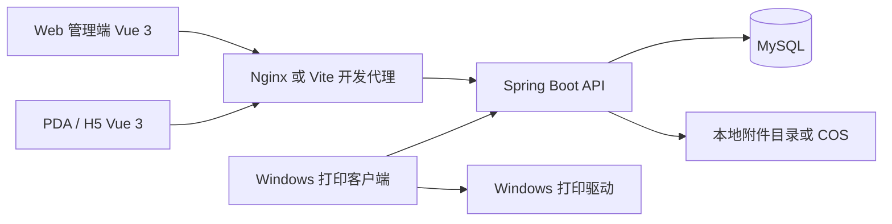

# 架构与模块

系统以车架 SN 为业务主线，维护电机、电池、仪表绑定，生成聚合二维码，并覆盖整车流转与历史追溯。业务代码可独立运行，不依赖其他公司项目、私有 Maven BOM、Nacos、Redis 或消息队列。

## 模块定位

| 包/目录 | 职责 |
| --- | --- |
| `auth`、`config`、`system` | 登录/JWT、首次改密、用户角色、权限、工位、系统配置 |
| `master`、`part`、`vehicle` | 车型/客户/仓库等主数据，零部件与整车档案、二维码 |
| `production` | SKU、任务、无序扫码、预占、隔离、标签、打印队列和附件 |
| `assembly`、`stock`、`rework` | 既有组装、出入库及返工换件；包含生产保护 |
| `order`、`lock`、`agent` | 既有单车型订单、数量锁库、代理商库存与采购意向 |
| `trace`、`dashboard`、`module`、`transfer` | 追溯、看板、列表、Excel 导入导出 |
| `bike-web/src/components/ProductionManager.vue` | Web 生产中心 |
| `bike-h5/src/components/ProductionStation.vue` | PDA/H5 作业入口 |
| `tools/print-client` | 标签渲染、系统打印提交与任务回报 |

## 分层及一致性

Controller 接收与校验请求，Service 定义业务能力，ServiceImpl 编排事务，Mapper 接口与 XML 执行数据库访问。新增 SQL 均放 Mapper.xml，不使用 Wrapper 拼接业务 SQL。V1–V15 是已发布历史迁移，保留原文件；V16 Java 迁移执行 `ProductionSchemaMapper.xml` 中结构定义。

任务扫描、部件预占、四码绑定、聚合码与首打记录在同一事务完成。数据库互斥行和唯一约束防止并发抢件，旧入口使用相同保护。锁库存到期由服务定时任务处理，不能绕过业务检查直接改库。

打印和文件系统不参与数据库事务。`SUBMITTED` 仅证明提交给 Windows 打印队列；超时任务进入 `UNKNOWN`，需核对实物后补打。附件写入失败不得产生可用记录，数据库失败会尝试清理本次对象；断电孤立文件需运维核对。

## 数据库版本

`bike_schema_history` 记录迁移。开发与生产 SQL 各有源文件和根目录镜像，均到 V15；V16 来自 Java Bean，运行最终版本为 16。开发 V4 含样例，生产 V4 仅初始化基础账号/角色/工位。两套迁移目录不能在已建库上随意切换，否则校验和不匹配。

新增变更使用新版本，不修改已运行迁移或随意执行 Flyway repair。恢复旧代码前需要停写并判断新预占/隔离规则是否仍被遵守。

## 当前边界

原型中售后案例、审批、配件发运等只用于交互评审。生产/PI PRD 中的 PI、收款、物流和多 SKU 订单尚未作为已完成功能交付。真实页面缺口见需求核查报告；本次仓库整理未顺带修复这些业务问题。
