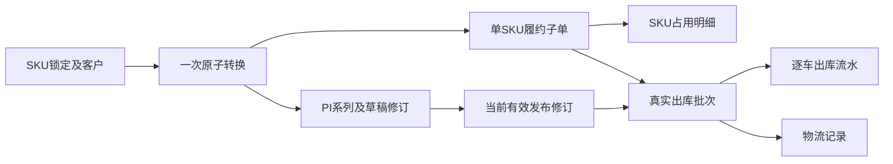

# PI 剩余核心闭环：最小兼容实施设计

复核日期：2026-09-21。性质：**技术设计与缺口复核，未实施证明、未验收通过报告**。本次只读业务代码，只新增本文件；运行实例是否已升级 V25/V26 不影响下列源码事实。迁移编号须在实施时取下一未使用版本，本文不占用版本号。

## 1. 结论与需求边界

PI 现有基础已支持真实 SKU 多行、商业资料快照、草稿编辑、收款幂等、人工放行、同车型 SKU 出库数量校验及 V25 收款保留占用。**尚未形成 SKU 精度锁库、多车型实际履约、锁定一次生成订单及 PI、正式修订和真实物流批次的完整闭环。** 这些都是可开发、可用隔离数据验收的代码缺口，不依赖现场打印机或正式业务样单才能开始。

依据为 [PRD](生产与PI订单接入_PRD_v1.0.md) 第 7 章数量守恒/事务、第 12 章待确认项，并交叉核对 6.5–6.8、10.1、11.3。PRD 是内部工作稿，T03/T04/T10/T11/T12 等未自动变为业务签字；本设计提出保守且可测的实现规则，不能用这些待确认项把已明确的代码能力排除出本期。原 PRD 的售后后置不覆盖后续会话另行授权的售后工作。

| 层级 | 内容 | 本次处理 |
| --- | --- | --- |
| 本期明确必做 | SKU 精确承诺、同 PI 多 SKU/多车型实际出库、锁→订单→PI 原子转换、幂等、版本留存、分批发货与物流关联、权限及旧入口不能绕过 | 直接形成下述实施与验收项 |
| 本期能力明确、业务参数待确认 | 48小时起算/晚登记规则、定金/发货门槛、直接客户与代理映射、正式编号、两套版式、币种/税费/舍入样单 | 先实现显式参数、受控配置、保守拒绝和隔离样例测试；正式模板发布与业务签认另列 |
| 真实交付验证依赖 | 正式 COS、现场设备、真实脱敏样单、纸质并行对账 | 单独验收，不能替代软件缺口，也不能被本地模拟标成完成 |
| 后期可选/排除 | 银行/支付/物流平台接口、自动汇率、税务发票、完整财务核销退款、商城、多组织WMS、通用模板设计器 | 不为本次最小闭环引入 |

## 2. 已核实的源码约束

| 位置 | 当前真实行为 | 后果 |
| --- | --- | --- |
| `lock/InventoryLockServiceImpl`、`InventoryLockMapper.xml` | 锁定仅有 `product_model_id`，要求代理商；按车型物理/承诺量判断 | 同车型不同 SKU 不能独立承诺；无直接客户锁定关系 |
| `stock/InventoryPolicyMapper.xml` | 共享承诺和库存投影均按 `model_id`，库位为展示分摊 | 生产库存能显示 SKU 不代表销售占用已精确到 SKU |
| `lock/LockOrderService.convert` | 事务生成单车型订单、占用并更新转换量；没有创建 PI | 当前锁→单和单→PI是两次独立操作，失败会留下未关联订单 |
| `order/OrderMapper.xml` | 一次查询直接联结车型明细；`increaseShipped/decreaseShipped` 按 `order_id` 更新 | 直接给现有订单插多明细会造成多行查询和多行误增减，不能只删单车型校验 |
| `PiServiceImpl.checkSourceOrder` | 来源订单必须单车型，PI 车型合计须相等；无来源 PI 可有多车型 | 多车型 PI 能保存/导出，不等于能选单实际出库 |
| `PiShipmentGuard`、`PiShipmentMapper.xml` | 通过唯一 `source_order_id` 找 PI；SKU余量按该订单已出库车计算 | 多订单共同履约时须重新定义 PI 聚合余量及当前版本 |
| V20/V25 `bike_order_reservation` | 主键为 `order_id`，一条车型占用，V25 已有 TIMED/PAID/RELEASED | 可沿用占用头及截止语义，但不能假装已是 SKU 明细 |
| V24 `bike_pi`、`PiMapper.insertPi` | `revision` 固定写1；`source_order_id` 唯一；只有草稿可编辑 | 阻止覆盖已发布内容是正确保护，但正式新修订仍未实现 |
| `StockServiceImpl.stockOut`、`StockOutRequest` | 一次请求一个订单、多个车；每车一个出库流水，响应只返回第一条；无请求标识 | 没有持久化的请求级批次，成功但响应丢失后不能返回原批次 |
| `PiServiceImpl.addLogistics` | 用户输入 `batchNo`；放行后带运单即可登记 SHIPPED | 可在没有实际出库时写成“已发货”，无法追溯真实出库车辆 |
| `PiDocumentService`、`PiController` | 每次同步生成 PDF/Excel，没有导出任务/存档；Excel金额为文本 | 还不满足 PRD 6.7 的任务状态、发布文件留存和数值金额列要求 |

## 3. 推荐结构：PI 聚合，保留单车型履约子单

最小兼容路线是保留现有订单的一条车型明细，不把旧 DTO 突然改成数组。新 PI 聚合多个履约子单；**新建子单每个来源锁定消耗对应一个固定 SKU**。同 SKU 来自两个来源锁时可有两个子单，PI 展示行按 SKU 合并，来源分配仍逐条保存。这样支持同车型不同 SKU 和不同车型一起履约，同时避免现有订单 Mapper 多行语义被破坏。

用户在新页面看到一份 PI、所有 SKU 的应发/已发/待发、关联子订单及真实出库批次，不需要分别手建多份 PI。出库一次可以扫描多个子单的车，在一个事务内提交一个批次。旧 `/api/orders` 仍以单明细显示每个子单，并新增只读 PI 关联字段。

这是一种内部履约实现，不缩减“一份 PI 多商品、一次批次多车型”的可见能力。现有 V24 单车型多 SKU 来源单作为兼容例外保留，以 SKU 分配明细约束；不拆改其既有单号和出库历史。

## 4. 数据与迁移设计

| 对象 | 最小变更及约束 |
| --- | --- |
| `bike_inventory_lock` | 新增可空 `customer_id/sku_id`、`scope_type=MODEL_LEGACY或SKU`；新接口 SKU、客户必填，车型从SKU派生。旧记录保持 MODEL_LEGACY；新直接客户锁允许代理为空，不制造虚假代理。旧接口原代理必填校验保留。数量始终大于0，释放+转换不超过原数量 |
| `bike_order_reservation` | 保留V25占用头、原截止、付款保留审计和PK；增加精度标志。其有效性不因修订/导出更新截止；SKU模式从子项求承诺，旧车型模式继续旧计算，两者不可同时计入 |
| 新 `bike_order_reservation_item` | `order_id,sku_id,ordered_qty,shipped_qty,closed_qty`，唯一 `(order_id,sku_id)`，三数量非负且 `shipped+closed<=ordered`；有效剩余=`ordered-shipped-closed`。新子单1项；旧V24可多项。`sku_id`对应车型必须等于旧订单车型 |
| 新 `bike_pi_series` | 稳定系列ID、唯一piNo、当前有效修订ID、下次版本号、乐观版本、创建信息。锁此行分配修订号；取消草稿不复用已分配版本号 |
| `bike_pi` | 加 `series_id,previous_revision_id,document_status,published_at,snapshot_hash`。现有每行继续代表一个商业修订；保留旧ID和`(pi_no,revision)`唯一键。商业快照发布后不可修改；付款/履约为独立聚合状态 |
| 新 `bike_pi_order_link` | `series_id,order_id,created_revision_id`，订单唯一归属一个PI系列；替代“仅用source_order_id找PI”作为执行依据。原source_order_id保留历史兼容，后续修订不复制该唯一字段 |
| 新 `bike_pi_order_allocation` | `series_id,order_id,sku_id`及原始来源关系，唯一 `(order_id,sku_id)`；关联占用子项。新子单一SKU，旧来源单可有多SKU。每个发布修订另存冻结的分配快照，数量调整不篡改旧修订 |
| 新转换/修订幂等记录 | `(operation,scope_id,request_id)`唯一，保存规范化请求摘要和结果系列/修订/子订单。相同请求重试返回原结果，不同内容冲突；不能只缓存进程内结果 |
| `bike_pi_payment` | 新增 `series_id` 并回填，原 `pi_id`保留“登记时依据的修订”；有效收款按系列求和，幂等改为系列+requestId。不能复制旧收款到新修订导致重复累计 |
| 新 `bike_stock_out_batch` | 服务端批次号、系列、执行修订、客户、requestId、payloadHash、状态、操作者和时间；请求唯一。逐车流水新增可空batchId、分配/SKU快照；批次关联所有子单 |
| `bike_pi_logistics` | 加seriesId、真实stockOutBatchId及登记幂等键；旧手填批次标记`LEGACY_UNLINKED`，不伪造关联；新SHIPPED记录必须引用有效真实批次 |
| 新发布文件/导出任务 | 修订+格式唯一对象，快照/模板内容摘要、状态、尝试次数、错误摘要、对象键/字节摘要；两种格式全部READY才整体完成。模板内容版本不可修改；模板名称字符串不是已锁定的模板本体 |

迁移必须增量追加并同步四处迁移目录，不能修改已应用的V20/V24/V25校验和。迁移中保留中文表/字段注释、外键和查账索引。使用Flyway属于当前已持续采用的工程路径；PRD T16是当时的待确认记录，不能在已获授权的兼容迁移工作中重新制造审批停顿。本次仅设计，不执行迁移。

### 4.1 历史回填规则

1. 每个已有PI创建系列，原revision=1、原ID不变；已有状态映射到文档/执行维度。不把有同样客户或日期的无来源PI自动关联订单。
2. 有来源的V24 PI回填系列—订单关系。SKU数量可由其真实明细确定；已发数必须逐车从当前有效出库记录和生产SKU核对。车型数量、SKU合计或历史车SKU缺失任一不一致，保持旧车型精度并列可查询核对项，禁止新接口用它声称精确承诺。
3. 唯一SKU且证据完整的旧车型订单可显式适配；同车型多SKU不能选第一项。不要求现场才能开发“歧义拒绝、明细补齐、核对报告”能力。
4. 回填不是重新锁库。保持原TIMED/PAID/RELEASED、原截止、原已发/关闭事实；过期收款不自动复活，旧转换无目标单的历史差异继续只读对账。
5. 旧库存车没有可核实SKU时归入“历史待识别库存”，不增加任一SKU可售量。仍存在的旧车型承诺按下一节保守保护，不能因无法回填而丢掉。
6. 旧逐车出库流水保留原单号。没有可靠请求/批次证据时按一条流水一个`LEGACY_SINGLE`技术批次回填，明确非原真实合批；不按相近时间猜批次。旧物流先标未关联，提供显式关联和审计，不自动变成已核验物流。
7. 原来未存档的旧PDF/Excel不能追认“与曾经下载字节相同”。首次归档标记迁移后生成时间及来源快照；后续重复下载字节固定。可以证明旧商业字段保留，但不能伪造旧文件留存证据。

## 5. SKU 库存与旧车型承诺并存

新承诺按SKU核算，车型为汇总，仓库/库位仍只做展示分摊。每SKU：`net=physical-quarantined-temporary-orderReserved`；返回`available=max(net,0)`和`shortage=max(-net,0)`，两个字段同时显示。缺口不能被另一SKU富余抵消。

旧车型承诺尚未明确SKU时，新增SKU锁/出库必须同时通过两层约束：

1. 该SKU合格库存减该SKU其他有效承诺，足以支撑本次数量。
2. 车型全部合格库存减全部SKU承诺再减未分配旧车型承诺，足以支撑本次**新增**承诺。履约时只加回本单自己已持有且尚有效的对应承诺，不能加回别人的承诺。

旧车型订单出库也逐车检查第1层，不能消耗其他订单的SKU承诺；其第2层可加回本单旧车型承诺。旧车型承诺转为SKU明细时，在同一事务中去掉对应旧口径并加入新口径，先验证精确SKU可用性，失败全部回滚。这允许正常SKU新业务继续进行，而不把历史歧义变成全项目现场阻塞。

界面单独列“历史车型未分配承诺”。`min(SKU空闲量,车型可新增量)`可作为某一SKU当前最大可申请数，但**不能将这个每行上限跨SKU相加冒充可售总量**；总量从共享投影计算。隔离一台已承诺车辆只产生缺口并阻止新增不足承诺，不自动释放订单。撤销入库同样校验被移除车辆具体SKU及车型两层支持。

## 6. 新接口与页面最小合同

以下为拟新增合同，未实现；准确命名可实施时统一，语义和权限不能省略。

| 接口 | 请求/返回重点 | 权限与行为 |
| --- | --- | --- |
| `GET /api/inventory/skus` | SKU分页，物理/隔离/临锁/订单占用/缺口、历史车型承诺；仓库过滤不重分全局承诺 | 复用库存读/代理范围 |
| `POST /api/sku-locks` | `{requestId,customerId,agentId?,items:[{skuId,quantity}],expiresAt?}`；返回锁定组及逐SKU锁ID | 内部锁库写；代理ID从会话绑定且客户需已授权，不能相信请求的归属 |
| `POST /api/pi-orders/from-locks` | `{requestId,customerId,agentId?,sources:[{lockId,quantity}],piDraft}`；返回seriesId、PI草稿、全部子单和占用 | 内部`AGENT_LOCK_WRITE+ORDER_WRITE+PI_WRITE`；客户/SKU/数量从来源带入并校验，整体原子提交 |
| `GET /api/pi-orders/{seriesId}` | 有效修订、逐SKU应发/已发/关闭/待发、子单、来源锁、逐占用状态、批次 | PI读；仓管用独立履约DTO，只给SKU/数量/是否可发，不给收款金额 |
| `POST /api/pis/{id}/revisions` | `{requestId,expectedRevision,reason}`；复制为下一草稿，返回新ID | PI写；只以当前有效修订为基线，拒绝过期并发编辑 |
| `POST /api/pis/{id}/confirm` | 发布新修订、校验分配差量、更新系列当前指针 | 已有合同扩展；首次/后续发布都不续期限，不自动放行 |
| `GET /api/pi-series/{seriesId}/revisions` | 所有版本、关系、发布快照与文件状态 | 历史已发布版本继续按系列归属授权 |
| `POST /api/pi-orders/{seriesId}/reservation/reacquire` | `{requestId,allocations:[id],hours,reason,expectedRevision}` | 订单写+锁库写；明确列出将竞争的SKU/数量，整次全成或全败；保留已登记收款 |
| `POST /api/stock-out/batches/validate` | `{seriesId,revisionId,vehicleQrCodes}`；逐车识别SKU/子单和错误 | 出库权限+工位，预检不承诺提交一定成功 |
| `POST /api/stock-out/batches` | 加requestId，返回真实批次、全部流水、逐SKU余量 | 同一事务重验；禁止自动缩量；请求重试返回原批次 |
| `GET /api/stock-out/batches/{id}` | 批次、逐车流水/有效性、关联订单与执行修订 | 仓管读；代理只读脱敏物流视图 |
| `POST /api/pis/{id}/logistics` | 增加stockOutBatchId与requestId；不把用户手填batchNo当外键 | 物流写；服务端校验同系列/客户、真实有效出库和状态 |
| `POST /api/pis/{id}/exports`、任务查询/下载 | 两格式任务、READY后授权下载，失败可重试 | PI导出；只读下载没有库存副作用 |

新接口保留明确错误码，例如`SKU_REQUIRED_FOR_LEGACY_MODEL`、`PI_REVISION_CONFLICT`、`SOURCE_QUANTITY_CONFLICT`、`SHIPMENT_BATCH_REQUEST_CONFLICT`、`LOGISTICS_BATCH_NOT_OWNED`。前端保存requestId直至结果明确；更改请求内容必须更换标识。原接口不能只隐藏按钮：旧订单写、锁转单、出库及撤销全部调用同一库存/当前PI门禁。

### 6.1 原子锁→订单→PI

锁住来源和目标范围后，校验来源同客户/代理、SKU启用、未过期、剩余量及合格库存支持；依次写幂等记录、履约子单、SKU占用、PI系列/草稿/分配、来源转换量与审计，一次提交。任何PI字段/明细/审计写入失败，全部回滚。为允许“先转为草稿再补价格”，新转换草稿可缺价格/条款但必须标记未完成且不可发布；旧`POST /api/pis`完整输入合同不必放宽。

部分转换沿用原截止；余下临锁与已转订单占用互斥。多来源不同截止不能取最大值续命；逐占用保留各自截止，详情展示逐项状态，整体仅在所有待发项有效时可发。响应不能用单个ACTIVE掩盖一行已到期。

### 6.2 多车型实际出库

先从扫描车辆读取稳定SKU，匹配当前PI发布快照及分配；同SKU多子单按明确稳定规则（最早截止、子单ID）选择且响应显示分配，不用车型替代。新批次在一个事务里处理全部子单，**不能HTTP循环调用旧出库接口而宣称批次原子**。可抽取StockService内部共同命令服务，但所有库存、放行、SKU、逐行余量、关闭/到期保护必须仍在事务内重验。

逐车流水存执行时revisionId/skuId/分配ID；更新对应子项已发量和原单明细聚合已发量；系列进度由所有有效子项计算。整批最后一车失败时，前面的物理库存、单据/明细已发数、占用、批次和审计全部回滚。提交成功响应丢失后同requestId返回原结果，不再出一次库。

关闭数不能冒充已发数。新履约DTO返回`orderedQty/shippedQty/closedQty/remainingQty`；全部实际发出才为SHIPPED，部分已发且剩余全部关闭为CLOSED，仍有待发则CONFIRMED/PARTIAL_SHIPPED。Web/H5改用服务端remainingQty。旧客户端不能正确表达“部分关闭后仍可发”的新状态时，写入口明确要求升级，不能把closedQty偷偷加进shippedQty或放任旧页面计算出的过大数量出库。

## 7. 不可变修订及财务连续性

1. `seriesId/piNo`代表同一业务，`pi.id/revision`代表一份商业快照。修订号在系列锁下单调递增；一个当前有效发布版本，可并存一个正在编辑草稿。草稿编辑不覆盖原发布行和原文件。
2. 发布事务校验expectedRevision、来源/SKU分配与当前库存，冻结客户/卖方/银行/商品/金额/条款、**实际模板内容版本**，替代旧当前指针，写任务与审计。旧版仅生命周期显示为被替代，商业快照和已归档字节不动。
3. 收款事实归系列，保留登记时的修订引用，绝不复制金额。新修订发布后按新发货条件重新授权放行；旧修订的放行不能自动授权新条款。收款门槛和“已全额付款”继续分开。
4. 已有收款或有效出库后，客户、代理归属和币种不能直接换成另一交易；最小方案明确拒绝并说明原因，保留现有事实。退款/重分账不属于本期，不能通过新修订清零或转移收款伪装完成。无财务/发货活动的归属修改仍须核对来源客户并原子调整关系。
5. 数量修改至少支持未履约部分：减少不得低于有效已发数，减少量明确关闭/释放；增加量必须重新争取对应SKU承诺，不延长原占用。为保留已付款旧占用语义，增加部分可新建履约子单及独立占用，而不是把整单PAID改回TIMED。已有PAID数量不因改总额自动释放；新增加部分按明确门槛处理并展示状态。
6. 同SKU已发部分不得改成其他SKU；改未发SKU必须原子释放旧SKU和申请新SKU。申请失败回滚全部变化，原发布版本继续有效。即使只改备注/银行/条款也必须新修订，银行配置修改需独立权限及前后值审计。
7. 收款发生在新草稿编辑期间按当时有效版本记账；新发布重新计算门槛，用户确认页面显示当前收款和分配结果，采用乐观版本防止在过时视图发布。
8. 到期后重新占用是独立、明确操作，不能以“修订”暗中复活。发布修订及重新占用可以在同一个显式提交中执行，但请求必须明示需重新竞争的行、时长和原因，并保持整次失败回滚。下载、预览、换模板不能续期。

正式金额口径待T04样单确认，不能默认税率/汇率。当前两位金额可作为明确的受限支持范围；不支持的小数位币种须拒绝或用配置计算，不能仅因是ISO三位代码就宣称全部币种正确。Excel数值列与16位整数精度存在真实冲突：支持范围内输出数值并核对精度，超出Excel15位有效数字的金额应明确限制/错误说明和精确文本附列，不能静默丢精度；最终支持范围记入规则表。

## 8. 真实物流与撤销

新物流记录的SHIPPED依据是**已存在且仍有效的真实出库批次**，人工运单只是补充资料。PLANNED可先保存计划，但没有有效出库不能升级SHIPPED。同一PI允许多个真实批次，每批有明确车辆/SKU/数量和运单；新UI从本PI有效批次选择，不手填内部ID。

最小规则是一批一个有效物流发运记录，可有多个运输单号作为该记录附属字段；合批/拆包裹和承运商API后期扩展。已出库但无运单显示“已出库，待登记物流”，不可显示未发货。计划单后续需要实际可执行的更新/确认入口，不能只能不断新增计划。

旧单车撤销入口同样识别批次。无物流确认的最新有效出库可按权限撤销对应车，批次变PARTIALLY_CANCELLED/CANCELLED且数量重算；已经登记实际物流发运时，仓管不能静默撤销制造“车在库但运单在途”。最小本期实现为授权物流撤回/更正（原因、审计、保留原记录）后才允许受控出库撤销，或者明确拒绝；实际客户退货另走后期流程。撤销恢复原SKU、原子单剩余与对应有效占用，已关闭/释放/到期沿用V25保护。

追溯按车架/当前及历史部件/总码均能回到执行修订、PI系列、子订单、批次与物流；历史修订查询保留当时信息，不随当前版本换成新的商业条款。

## 9. 锁顺序、时间与事务边界

保留现有 `ProductionGuard` 全局数据库互斥作为第一阶段正确性基线，暂不为性能引入Redis库存或MQ。统一写链路顺序：

`全局库存/生产互斥 → 代理授权行（如需，ID升序） → 车型/SKU行（ID升序） → 来源锁定（ID升序） → 订单头（ID升序） → 占用头/子项（ID/SKU升序） → PI系列/修订 → 收款行 → 车辆（ID升序） → 批次/流水 → 审计与导出任务`。

非锁读仅可发现关联ID；取得前置锁后必须重新核对归属和当前修订。付款、转单、续占用、发布修订、批量出库、撤销、取消/关闭和到期任务不得反向持锁。当前V25基本顺序是库存→订单/占用→PI，新增系列锁不能在入口先取系列再反向取订单。纯权限授权编辑如只取代理行且不访问库存可保留；若未来跨库存同事务，必须遵循统一顺序。

所有关键时限在获得冲突锁后的条件更新中用数据库`NOW(3)`判断，不能依赖应用时钟预检或事务开始前缓存时间。多来源PI的付款应保留到账事实，对仍有效且达门槛的行转PAID，已过期行保持需重占；返回逐行结果，整体发货受未解决行限制。已到期后同收款requestId重试不得顺便重占。

库位过滤仅改变展示集合，不能改变全局承诺分摊或写入上限。下载/COS/模板渲染在提交后执行，不长期持有库存锁；数据库先写唯一任务，外部失败可重试并可查询。任务领取用数据库条件抢占及租约，实例重启/并发不生成多个同修订“正式文件”。

## 10. 旧接口兼容与切换

- 旧订单请求仍接受`modelId/orderQty`，维持单明细。唯一明确SKU可适配；有歧义时提示升级，不默选。新生成SKU子单即使被旧接口调用也不能改客户/数量绕过PI修订。
- 旧车型锁可以保留为MODEL_LEGACY并纳入双层库存保护；通过新PI转换前必须显式分配SKU。旧只增convertedQty的`/convert`继续拒绝。现有`/{lockId}/orders`返回类型不改；增加“创建PI”的新版入口，旧订单-only流程如继续允许必须标为未建立PI，不能算完整转换。
- 旧`/api/stock-out`保留响应兼容，但内部也写真实批次并走相同SKU/系列当前版本门禁；旧无requestId调用仍保留防重复出库，新增批次接口提供完整重试结果。不能让旧入口绕过已到期/未放行/错误SKU。
- 旧`GET /api/pis/{id}`仍查该具体修订；付款/物流写入明确记录其登记依据，并在过时修订上提示刷新当前版本，不能错误绑定旧放行。代理历史已发布修订可读，草稿及财务字段继续隔离，导出/附件/通用日志一致。
- 写开关按“SKU锁→聚合转换→修订→付款→出库→撤销”整链切换，不能只启新建而留旧库存统计忽略它。新旧承诺对账通过后启用；已有新数据后禁止回退不识别新表的旧服务继续写，采用只读停写、兼容版本或前向修复。

## 11. 关键验收矩阵

下表均为**待实施/待执行**，不因本设计完成而判通过。接口/数据库检查与普通岗位真实UI各留证据；最终两轮验收应在同一冻结版本完整执行。

| 编号 | 核心用例 | 不可省略的断言 |
| --- | --- | --- |
| P01 | 同车型红/蓝各1台，只锁红1；两请求抢最后红车 | 仅一个成功；蓝不补红缺口；库存/导出/看板口径一致 |
| P02 | 2个SKU临锁各2，转换1+2到同PI；含不同车型 | 1份PI、真实子单和来源关系；可售不回升；未转1仍保原期限 |
| P03 | 转换最后一步PI明细/审计失败 | 无新PI/订单/占用、来源convertedQty不变 |
| P04 | 同requestId并发重试/不同内容冲突 | 只生成一套结果；冲突明确，不能生成第二单 |
| P05 | 多车型PI一次扫2种车型，各分批发一部分 | 同一真实批次关联所有流水；逐SKU/子单/PI余量正确 |
| P06 | 最后一车错误SKU、隔离或超行量 | 整批全回滚；前车、占用、计数和批次均无残留 |
| P07 | 提交成功响应丢失后重试 | 返回原批次所有流水；不重复扣物理/占用 |
| P08 | 到期前/精确截止/截止后与收款并发 | 数据库时间决定；到期不能保留，到账事实不丢；重复调度无重复释放 |
| P09 | 多来源一行有效一行过期后收款 | 有效行按门槛保留，过期行需重占；不能把整PI显示全部可发 |
| P10 | 到期后收款并重占，库存已被别人占走 | 保留收款，重占全失败；未抢走他人库存；补足后显式成功 |
| P11 | 两人从同版本修订并发布 | 无同版本覆盖；旧文件、快照保留；过期编辑被拒绝 |
| P12 | 修改客户/SKU/银行主数据，再下载旧版本 | 商业内容与存档摘要不变；两格式同一快照；草稿有水印 |
| P13 | 已收款/部分出库后修订数量/条款 | 已发不被抹掉；减少不低于已发；增量重验；收款不复制；新版本重新放行 |
| P14 | 改未发SKU但新SKU不足 | 修订发布失败且旧有效版本/原承诺完整不变 |
| P15 | 真实物流SHIPPED前无出库、跨客户/PI选批次 | 全部拒绝；任意手填batchNo不能作为发货证据 |
| P16 | 同PI多批出库登记物流、撤回/撤销 | 批次数量与有效流水一致；原物流留痕；已关闭订单不能重开 |
| P17 | 旧车型承诺与新SKU承诺竞争 | 双层守恒；旧出库不能吃新SKU承诺；未知SKU不虚增可售 |
| P18 | V24单车型多SKU、无SKU老车、旧手填物流升级 | 能核实的准确回填，歧义明确待核对；原ID/时间/状态/历史不变 |
| P19 | 旧订单/锁/出库接口绕过尝试 | 同一SKU/付款/占用门禁；旧DTO兼容且多明细不会误更新 |
| P20 | 普通业务/财务/仓管/代理交叉权限 | 各自能完成工作；财务金额/凭证/持有时间/通用日志不泄露；代理不能通过截止空值区分付款方式 |
| P21 | 三种追溯入口及旧部件码 | 返回正确车、执行修订、系列、子单、真实批次和物流 |
| P22 | 一种导出失败、COS失败、进程重启重试 | 数据/库存不回滚；整体不标READY；成功格式不被无故重建；授权下载有效 |
| P23 | 空库迁移、V24/V25升级、兼容回退演练 | 四套迁移一致，数量/金额/外键核对；旧服务不允许带新数据继续写 |

## 12. 建议实施顺序与完成门槛

1. 先落SKU承诺明细、历史双层库存口径和统一门禁，用MySQL并发/守恒测试证明新旧共存；不要先开放新前端让统计漏算。
2. 再落PI系列/关系及原子转换，提供普通业务员可用页面，跑P01–P04、P17–P19。
3. 再落聚合出库批次、幂等与撤销、物流真实关联和追溯，跑P05–P07、P15–P16、P21。
4. 再落不可变修订、财务连续性、模板发布/导出任务与文件存档，跑P08–P14、P20、P22。系列基础应在第2步已具备，避免先把收款绑定到可变文件版本。
5. 完成迁移/权限/旧入口全回归及普通角色UI，冻结代码后完整执行两轮。业务模板、金额样单、正式存储和现场验收分别登记状态；任何未实现的软件闭环继续保留为软件未完成项，不能归入“等现场”后宣称完成。

本设计没有要求重做生产底座、引入第三方系统或删除历史。它明确补齐当前跨模块数据关系和事务语义；这些实现及上述验收未完成前，项目只能称PI基础可用，不能称PI完整履约已交付。
