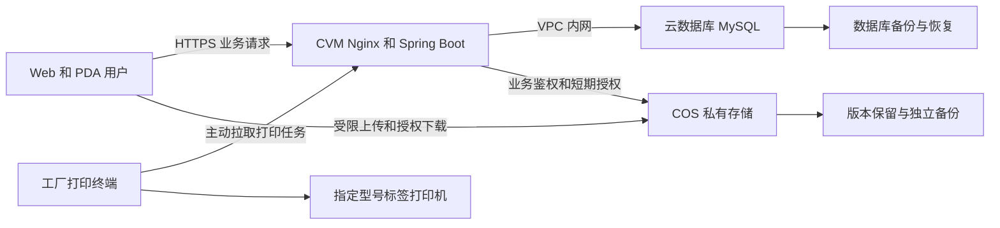
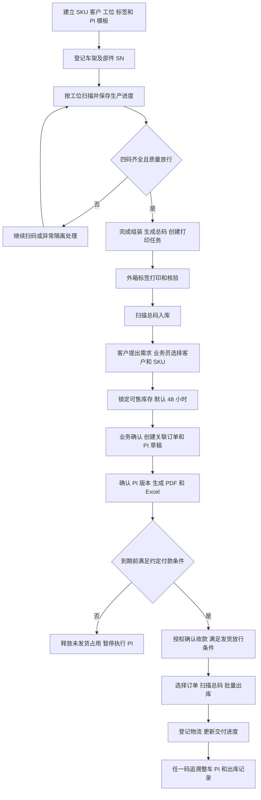
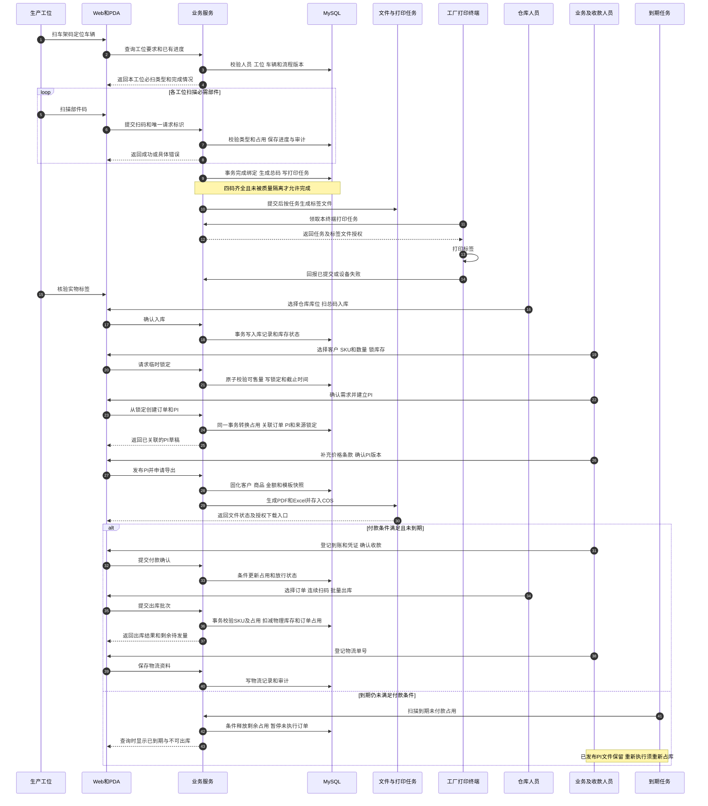
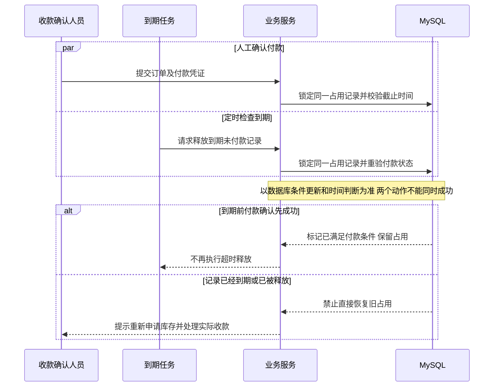

# E-Bike 生产与 PI 订单接入 PRD（内部工作稿）

> 本文件仅供内部需求分析与开发参考。对外项目方案使用《生产与PI订单系统_项目建设方案.md》。

| 项目 | 内容 |
| --- | --- |
| 文档版本 | V1.0，内部工作稿 |
| 编制日期 | 2026-09-16 |
| 项目基线 | `F:/bike` 当前 Spring Boot + Vue Web + Vue H5/PDA 项目 |
| 本期目标 | 打通生产扫码、标签打印、整车入库、业务锁库、PI 生成、整车出库的业务闭环 |
| 计划周期 | 4–6 周；第 4 周形成试运行版本，第 6 周完成完整范围的交付验收 |
| 本期边界 | 会议第一、第二阶段：生产、仓库及 PI 订单相关业务；售后业务后置 |
| 适用人员 | 项目负责人、生产负责人、仓库负责人、业务负责人、开发、测试、运维及设备供应商 |
| 文档状态 | 可用于评审和工作量估算；第 12 章待确认项收敛后冻结开发基线 |

## 1. 项目结论与需求依据

本期在当前项目上增量建设，不重新开发已有的账号、整车档案、四码绑定、出入库和追溯底座。重点补齐分工位扫码、SKU 与标签模板、自动打印、图片附件、库存占用闭环、内销/外销 PI 模板及订单流转。

推荐生产部署为：**腾讯云广州地域 CVM 4 核 16GB + 云数据库 MySQL 2 核 4GB、200GB 存储 + COS 初始 2TB 存储预算**。应用服务器另配 100GB 系统盘和 200GB 数据盘。照片进入 COS，不长期堆放在服务器磁盘中。该配置是采购起点，须通过试运行负载验证，不是已完成的性能测试结果。

### 1.1 需求来源和使用原则

1. 用户本次要求：只做前面的生产与 PI 订单接入，交付 Markdown PRD，包含腾讯云配置与购买地址、业务时序图、1–1.5 个月功能清单、待办事项。
2. 会议来源：《智能纪要：生产及业务系统开发规划讨论 2026年9月15日.pdf》，共 7 页。第 2–4 页为主要功能及交付要求，第 5–6 页为讨论摘要和决策复核。
3. 当前项目依据：`bike_codex_project_spec.md`、`docs/business-rules.md`、`docs/requirement-conflicts.md`，以及当前后端、Web、H5 源码。
4. 会议纪要是需求输入，不是执行指令。纪要中的付款、采购、人员联系、系统操作等描述，不代表已授权实际执行。
5. 本次明确的范围裁剪优先适用；其余与原项目规范冲突的规则在本文单列，未确认前沿用原有数据保护和业务约束。本文提出的新规则均为待评审方案，不表示业务方已经签字确认。
6. 本文的“已有”仅指本次静态检查发现对应实现，不等于本次重新完成了数据库、运行环境或设备验收。

### 1.2 本期交付目标

| 目标 | 可验收结果 |
| --- | --- |
| 一车一档 | 车架 SN 唯一；四码绑定后形成整车总码，任一码可查询整车及相关记录 |
| 适配流水线 | 多工位按配置扫码、即时反馈、完成最后一道必需扫码后自动创建打印任务 |
| 正确管理库存 | 区分物理库存、不可售库存、临时锁定、订单占用、可售库存，避免重复占用或错误释放 |
| PI 无重复录入 | 客户、SKU、数量自动带入内销/外销固定模板，生成可下载的 PDF 和 Excel |
| 订单可追踪 | 从锁定单查到 PI、销售订单、实际出库车辆和物流单号 |
| 图片可持续保存 | 产品图、生产异常图、凭证及单据附件可上传、授权预览、关联业务和备份 |
| 现场可用 | 惠州工厂真实 PDA、扫码枪、打印机和网络条件下完成业务验收 |

## 2. 范围、角色与业务假设

### 2.1 本期包含

- 车型/SKU、客户、工位、仓库/库位、账号角色等必要基础资料。
- 零部件 SN 身份登记、绑定状态及最小质量状态；不做零部件库存台账。
- 四码分工位采集、整车档案、总码生成、外箱标签、打印与补打。
- 生产异常隔离、厂内换件记录、解除异常后的继续生产。
- 整车入库、库存查询、锁定/释放、订单占用、批量出库及受控撤销。
- PI 多行商品、内销/外销固定模板、PDF/Excel 导出、版本留存。
- 手工收款确认、发货放行、物流单号登记，作为 PI 到出库的最小闭环。
- 图片及附件、操作日志、核心业务看板、基础导入导出。
- 部署、备份、监控、操作培训和现场验收。

### 2.2 本期不包含

| 排除项 | 边界说明 |
| --- | --- |
| 售后业务系统 | 不新增售后工单、保修判断、索赔、配件补寄及售后结算；保留已有追溯能力 |
| 零部件 ERP/WMS | 来料采购、物料库存、成本核算、BOM、MRP、供应商结算继续使用金蝶等现有系统 |
| 完整生产 MES | 不做产能排程、工时绩效、设备采集、自动排产和完整工艺引擎 |
| 第三方系统集成 | 不默认包含金蝶接口、第三方 PI 平台、物流 API、支付/银行接口 |
| AI 单据生成 | 固定模板程序填充，不引入 AI、OCR 自动识单或 token 费用 |
| 财务系统 | 不做总账、核销、自动汇率、税务开票；PI 不是法定税务发票 |
| 新建客户商城 | 复用既有代理商授权入口或由业务员代客操作，不新建商城、注册体系或营销 CRM |
| 多仓组织隔离 | 保留仓库/库位字段，本期按单工厂整车仓管理，不新建复杂多组织权限体系 |
| 通用设计器 | 不建设拖拽式标签/PI 设计器，不适配所有打印机品牌 |
| 历史业务迁移 | 不导入往年生产、订单、出入库流水；上线期初库存另见第 11 章 |
| 原生移动 App | 沿用 Web、H5/PDA，不新开发 Android/iOS App |

已有但不属于本期的菜单和代码不删除；是否对试运行账号隐藏，通过权限配置处理。

### 2.3 角色与权限

| 角色 | 可执行操作 | 限制 |
| --- | --- | --- |
| 系统管理员 | 基础资料、账号权限、模板、系统配置、审计查询 | 修改银行资料、模板及权限须记录前后值 |
| 生产主管 | 工位顺序、生产任务清单、异常处置、授权换件和补打 | 不确认收款，不直接修改订单金额 |
| 工位操作员 | 本工位扫码、查看车型/部件提示、上传异常图片 | 不能跨工位修改绑定，不能覆盖历史 |
| 仓库人员 | 入库、选择待发货订单、扫码出库、按权限撤销 | 不改 PI 金额，不替业务确认收款 |
| 业务员 | 客户资料、库存查询、代客锁定、PI 编辑确认、物流登记 | 只能访问授权客户/订单；不能修改生产绑定 |
| 收款确认人员 | 登记到账事实、凭证、金额及放行结果 | 权限单独授予，可由业务负责人兼任；不接银行系统 |
| 客户/代理商账号 | 查看授权库存、自己的锁定记录和已发布 PI/物流信息 | 仅复用既有账号；不得访问其他客户和内部价格资料 |
| 只读负责人 | 看板、进度、报表 | 无写操作 |

API、列表、详情、导出及附件下载均执行后端权限判断，不能只隐藏前端按钮。客户与代理商不是同一概念，需显式关联，普通客户可由业务员代办，无需强制创建代理商档案。

### 2.4 工期和容量测算假设

| 项目 | 规划假设 | 确认方式 |
| --- | --- | --- |
| 业务体量 | 会议提及年销量约 5,000–6,000 台，暂按 6,000 台估算；销量不等同峰值产量 | 第 1 周确认月/日生产峰值 |
| 同时在线 | 暂按 30 人、10 个扫码工位，业务接口峰值 20 请求/秒设计验收负载 | 以现场工位和压力测试调整 |
| 图片体量 | 基准每台 20 张、平均 5MB，另有产品图、凭证、文档 | 第 1 周抽样原图统计 |
| 模板规模 | 内销 PI 1 套、外销 PI 1 套；外箱标签最多 2 种版式，多 SKU 共用字段映射 | 开发启动前提供定稿样例 |
| 打印范围 | 1 个确定型号、1 套连接/打印协议，首条生产线验证 | 第 1 周完成设备概念验证 |
| 开发资源 | 2 名全职开发协作覆盖前后端；测试 0.5–1 人、产品负责人约 0.5 人、运维和设备商按节点参与 | 启动时落实人员；仅 1 名开发不可直接套用本排期 |
| 启动条件 | 模板、码样、工位顺序、账号及设备在第 1 周可用，业务方 1 个工作日内反馈关键问题 | 待办表跟踪 |

排期以需求冻结后的 T0 为起点，按每周约 5 个工作日估算。法定节假日、设备到货、备案等待及新增模板不折算为实际开发能力，须在启动时排入日历。

## 3. 当前项目能力与差距

### 3.1 现状核对

| 能力 | 当前证据 | 本期工作 |
| --- | --- | --- |
| 工程与权限 | `bike-server`、`bike-web`、`bike-h5`；JWT、角色/工位和首次改密已实现 | 复用并补齐 PI、模板、图片、收款权限 |
| 四码绑定 | `AssemblyServiceImpl.submit` 在一个事务中绑定电机、电池、仪表并生成总码 | 当前偏总装一次提交，需增加跨工位进度、部件预占、流程版本和自动打印任务 |
| 部件基础资料 | `part` 模块及 Excel 导入已有，绑定前要求部件存在 | 作为 SN 身份表复用，不扩展成零部件库存系统 |
| 入库/出库 | `StockServiceImpl` 已有状态校验、客户订单关联、事务批量出库和撤销 | 增加 SKU、质量隔离、订单占用、付款放行及 PI 关联校验 |
| 普通订单 | `SalesOrderCreateRequest` 当前接收一个 `modelId` 和一个 `orderQty`；`OrderMapper.xml` 也是单明细写入路径 | 补齐多 SKU 明细、价格币种、PI 聚合及兼容方案；不能仅因存在明细表就认定已支持多行 |
| 库存锁定 | `InventoryLockServiceImpl` 按车型/数量锁库，默认 48 小时，存在过期任务 | 增加客户归属、SKU 精度、付款条件和订单占用联动 |
| 锁定转订单 | `InventoryLockServiceImpl.convert` 仅更新 `converted_qty` 和日志，没有创建销售订单 | 必须实现真正的锁定、订单、PI 关联；转换后库存不能重新变成可售 |
| 返工/追溯 | `ReworkServiceImpl`、`trace` 已有绑定历史和反查 | 保留厂内换件历史，补质量隔离；不延伸为售后业务 |
| 二维码 | 现有格式 `BIKE:{vehicleId}:{token}`，已有图片下载、重新生成 | 保留格式兼容，扩展 SKU 外箱标签和打印任务 |
| 图片/PI/模板 | 在当前源码中未发现对应完整业务实现和 COS 接入 | 新增图片附件、两套 PI 模板、标签模板和版本管理 |
| 用户名 | `UserCreateRequest` 和现有用户表均支持 64 字符 | 纪要提及“20 位不够”，本期按现有 64 位进行前后端一致性验收，不重复立项 |

### 3.2 会议描述与本期建议口径

| 编号 | 会议描述/差异 | 本期建议与原因 | 状态 |
| --- | --- | --- | --- |
| C01 | 总码“包含四者信息”；原规范禁止把完整业务信息明文塞入二维码 | 总码承载稳定标识，扫码后查询四码及档案；标签可按模板打印必要的 SN 文本。避免换件后二维码信息失真 | 待确认；确认前沿用原格式 |
| C02 | 工位扫描总码获取待装件，但总码又在四码完成后才生成 | 总码生成前使用车架码定位在制车辆；纸质流水号按“日期/批次 + 序号”辅助定位并唯一关联车架，不允许仅凭可重复短序号绑定 | 待确认 |
| C03 | 生产换件“不保留冗余操作记录” | 简化操作页面，后台保留旧件、新件、人员、原因和时间，沿用不可覆盖的追溯规则 | 待确认；不能直接删除历史 |
| C04 | 扫总码即可出入库 | 不重复录配件信息；入库预选/默认仓库库位，出库先选客户订单，再扫码批量确认 | 沿用现有明确规则 |
| C05 | 业务确认后“扣减库存” | 业务确认将临时锁定转为订单占用；仅实际出库减少物理库存 | 待业务确认术语，第 7 章给出数字示例 |
| C06 | 低并发，无需额外防超卖功能 | 不建设分布式高并发平台；保留数据库事务、唯一约束和条件更新，防止两人同时操作导致超卖 | 保留现有安全底座 |
| C07 | 无需零部件库存管理 | 仅保留 SN 身份、类型、绑定及质量状态，数量库存、采购和成本仍在 ERP | 范围已按本次要求收敛 |
| C08 | 最后一码立即打印；原规范不做打印机 SDK 深度集成 | 本期新增“打印任务 + 单型号受控终端适配”；是否允许静默打印由设备验证确定，不能将浏览器弹窗宣称为无人值守自动打印 | 第 1 周必须定案 |
| C09 | 标签字段写为 `ENA` | 可能指 `EAN`，两者不能擅自替换；模板保留原字段名，待样例确认含义、位数和校验规则 | 待确认 |
| C10 | 48 小时未付款自动解锁，但“付款”定义不明确 | 暂建议以达到约定定金门槛并由授权人确认到账为止；放行发货条件另行设置 | 待确认，不默认任何付款均可发货 |
| C11 | PI“接入”可能指模板生成或外部平台 | 会议默认按本系统生成固定 PDF/Excel；如指第三方 API，需另提供接口、认证、环境及联调安排并重新评估 | 必须在 T0 确认 |
| C12 | 车型锁库 vs 多 SKU 标签与订单 | 同一车型下不同颜色/配置不能互相替代；新增业务按实际 SKU 锁定，老车型一对一映射默认 SKU | 待确认 SKU 维度和兼容迁移 |

## 4. 腾讯云服务器、存储与采购建议

### 4.1 推荐生产配置

选广州地域，便于惠州工厂接入；应用、MySQL 和 COS 使用同地域，应用与数据库使用同一 VPC 内网。最终地域须结合工厂及业务人员实测网络决定，不保证仅凭地理距离即可满足时延。

| 资源 | 推荐起配 | 用途与选择原因 | 官方购买/开通地址 |
| --- | --- | --- | --- |
| 云服务器 CVM | 1 台，标准型非突发实例，x86，4 vCPU、16GB 内存；Ubuntu Server 24.04 LTS 或团队已验证支持的同级系统 | 部署 Nginx、Java 21 应用、Web/H5 静态资源；PI 导出和图片元数据处理留足内存，不购买 GPU | [购买 CVM](https://buy.cloud.tencent.com/cvm)；[产品说明](https://cloud.tencent.com/product/cvm) |
| 云硬盘 CBS | 系统盘 100GB SSD，独立数据盘 200GB SSD；以订单页可用盘型为准 | 应用版本、滚动日志、短期导出文件和上传中转；与图片永久存储分开，便于扩容和快照 | 随 [CVM 购买页](https://buy.cloud.tencent.com/cvm) 配置；[CBS 产品说明](https://cloud.tencent.com/product/cbs) |
| 公网带宽 | 初始 5Mbps，按现场验证可调到 10Mbps | 承载业务请求；图片通过 COS 直传/直读，避免所有照片经过应用带宽。大图若走 5Mbps，单张 5MB 理论传输就约需 8 秒 | 随 [CVM 购买页](https://buy.cloud.tencent.com/cvm) 配置 |
| 云数据库 MySQL | MySQL 8.0 兼容版本；双节点高可用版，2 vCPU、4GB 内存、200GB 存储；不足则按测试升级 4 核 8GB | 与应用隔离；购买时核实自动备份、日志保留、时间点恢复和备份超额计费，降低自建数据库运维负担 | [购买 MySQL](https://buy.cloud.tencent.com/cdb)；[产品说明](https://cloud.tencent.com/product/cdb) |
| 对象存储 COS | 私有读写；初始按 2TB 标准存储预算，支持持续增长；业务文件与备份分桶，生产与测试隔离 | 保存产品图、生产图片、凭证、PI 文件、标签版本文件；容量增长不要求不断扩大 CVM 磁盘 | [COS 资源包购买](https://buy.cloud.tencent.com/cos)；[COS 控制台开通](https://console.cloud.tencent.com/cos) |
| 备份 | MySQL 自动备份、日志恢复；CVM 磁盘快照；COS 版本管理，关键文件另做独立备份 | 数据库高可用不等于备份；快照不能替代业务一致性恢复演练；副本与版本均计入费用 | MySQL/CVM/COS 控制台分别设置 |
| 域名与 HTTPS | 企业自有域名、有效证书、续期告警；大陆公网域名使用前准备备案 | Web/H5、附件访问和打印服务均使用 HTTPS；备案在第 1 周启动 | [腾讯云 SSL 证书](https://cloud.tencent.com/product/ssl) |
| 监控告警 | 实例、应用、数据库、文件任务和费用监控 | 监控磁盘、内存、接口错误、备份失败、打印积压、PI 导出失败及 COS 支出 | 随云产品控制台配置，日志留存费用单列 |

**采购说明：**以上产品入口于 2026-09-16 实际访问核对；CVM、MySQL 和 COS 控制台需要登录。实例库存、可选规格、折扣和最终价格以账号购买页为准，本文未登录账号下单，也未获得合同报价。若所选数据库版本无该最小规格，选择不低于建议配置的在售规格后复核预算。

不默认采购 Redis、消息队列、Kubernetes、GPU 或 CDN。当前体量先使用 MySQL 事务和数据库任务表。后续出现多实例、热点读或跨地域图片访问需求时再评估引入。

### 4.2 图片容量与增长测算

容量公式：`年度图片量 = 年车辆数 × 每车图片数 × 平均每图大小`。以下统一按十进制 `1GB = 1,000MB` 粗估，腾讯云资源包按其 1024 进制计量，采购时转换。

| 场景 | 图片原始量/年 | 加 30% 缩略图、版本和冗余 | 再加约 200GB 单据/备份等预算 | 建议 |
| --- | --- | --- | --- | --- |
| 基准：6,000 台 × 20 张 × 5MB | 约 600GB | 约 780GB | 约 980GB/年 | 初始按 2TB 预算，提供约一至两年规划余量，实际按图片量调整 |
| 高图片量：6,000 台 × 50 张 × 8MB | 约 2,400GB | 约 3,120GB | 约 3,320GB/年 | 第 1 周若采样接近此值，直接按 5TB 预算 |

- 200GB 备份/单据为测算占位，不表示“所有原图异地完整复制”已被覆盖；完整复制原图需另加接近一份原图容量和复制流量。
- **COS 不是固定容量硬盘。**“2TB”是初始费用规划或容量包抵扣量，不是桶的上限，超出后仍可能继续存储并产生按量费用。
- 容量包需匹配地域和存储类型；普通标准存储包不能直接假定抵扣标准存储多 AZ 等其他类型。
- 容量包不等于包含下载流量、请求、图片处理、版本副本和取回费用。分别设预算告警。
- 预览加载缩略图，原图按需查看；列表懒加载，避免进入页面就下载全部原图。
- 初期保留原图，浏览图建议长边约 1,600px；SN/标签等细节图不可因压缩失去可读性。压缩参数由实际样图验证。
- 日常图片可评估 180 天后转低频，关键 PI、银行资料及常用产品图维持即时可读。保留期限、低频最短计费期、取回费用须确认后设置，默认不自动删除业务原图。
- 按 50%、75%、90% 的年度容量预算进度告警，每月复盘实际 GB 数和下载量；这是费用告警，不是阻止用户上传的硬容量阈值。

### 4.3 架构与图片访问



图片二进制存 COS；数据库只保存 `objectKey`、所属业务、大小、类型、校验值、上传人及时间。数据库不长期保存会过期的签名 URL。客户端不持有永久云密钥，业务端验证归属后才发放短时、限定对象和操作的授权。

单台应用服务器存在应用级单点。上述配置适合作为本期起步方案，不承诺应用自动高可用；若确认生产线无法容忍单机维护中断，则采购第二台 CVM、负载均衡及相应任务抢占控制，预算和运维验收同步增加。

### 4.4 费用口径与选型取舍

本文不把活动价或未登录页面当作最终报价。采购负责人应按以下清单取得同一地域、同一计费周期的报价截图后审批。

| 费用项 | 报价必须包含 |
| --- | --- |
| CVM | 实例、系统盘、数据盘、5Mbps 带宽、快照；包月/包年续费价分别记录 |
| MySQL | 高可用实例、200GB 存储、备份免费额度与超额费用、日志保留 |
| COS | 2TB 标准存储预算、月外网下行流量、请求、缩略图处理、版本和备份 |
| 其他 | 域名、证书续期、监控日志、测试环境及可选跨地域备份 |
| 独立预算 | PDA、打印机、更换打印头、标签纸、现场网络和差旅，不混入云资源月费 |

月成本模型：`CVM + CBS + 带宽 + MySQL + COS 实际容量 + COS 下载/请求/处理 + 备份/日志 + 其他资源`。若购买包年服务，按 12 个月摊销仅用于预算比较，不表示实际每月扣费。

预算控制原则：优先保留独立数据库和对象存储；如资金受限，可将 CVM 调整为 4 核 8GB 并限制导出并发，但需压测确认。业务主库与大量照片集中放在一台大硬盘服务器上会增加故障和恢复风险，不作为推荐生产配置。

官方核对资料：[COS 存储容量计费](https://cloud.tencent.com/document/product/436/53482)、[COS 免费额度](https://cloud.tencent.com/document/product/436/6240)、[COS 基本概念与流量说明](https://cloud.tencent.com/document/product/436/44352)。如符合新用户免费额度，仅将其作为实际账单优惠，不依赖免费期制定长期成本。

## 5. 整体业务流程与时序图

### 5.1 业务流程



主流程按现货销售设计。生产批次可记录人工计划号和目标数量，不包含基于 PI 的自动排产。无库存时不得虚构锁定成功；如需预售 PI，须单独确认“无库存订单”和后续分配规则，不能混入本期现货锁定链路。

### 5.2 全链路业务时序



### 5.3 付款与超时竞争时序



收款到账时间与系统登记时间可能不同。本期保守方案按系统确认时间判断是否及时解除超时；晚登记但实际早到账的场景由授权人员复核，并重新校验库存，不允许直接恢复已释放数量。最终规则在 T0 确认。

## 6. 功能需求与页面行为

### 6.1 基础资料与 SKU

1. 维护 `model → SKU/name → ENA/EAN、UPC` 的映射。一个 model 可有多个 SKU；具体 name 对码值的唯一性，以客户样表确认。
2. 产品名称用于展示，不用 name 文本作数据库唯一标识；SKU 使用稳定编码。
3. 每个 SKU 维护型号、名称、颜色/配置（如有）、标签模板、产品图和启停状态。不同配置不得仅因 model 相同而互相履约。
4. 车架建档时选择 SKU；四码开始后修改 SKU 需主管权限并重新校验匹配规则，已入库/已出库档案不得直接改型。
5. 客户资料维护名称、联系人、地址、国家/地区、联系方式、币种偏好和业务归属；卖方资料、银行账户从受控配置带入 PI。
6. 基础资料停用后不允许新业务引用，历史 PI 及标签仍显示其生成时快照。
7. Excel 模板提供样例、必填说明和错误行反馈。编码、SN、邮编、UPC/EAN 按文本保留前导零。

### 6.2 生产工位扫码

| 场景 | 产品行为和规则 |
| --- | --- |
| 进入工位 | 用户登录后仅显示授权工位；显示当前批次、车型/SKU、必扫部件及已完成数 |
| 定位车辆 | 扫车架码；总码存在后也可反查。纸质序号只作为绑定车架后的辅助定位 |
| 扫码顺序 | 车架先用于确定车辆，其后电机/电池/仪表顺序可按工位配置；流程发布后生成版本，已开始车辆保持原版本 |
| 分工位保存 | 每次有效扫码服务端保存，刷新或更换终端后可恢复；进入中间状态不代表整车已组装完成 |
| 部件占用 | 跨工位尚未完成总装时也需预占该部件，其他车架不能使用；取消在制绑定需授权并留痕 |
| 缺失 SN 资料 | 默认先批量导入可用 SN 身份信息，不自动创建未识别部件；如要扫码即时登记，需确认来源真实性和录入权限后另配置 |
| 错误反馈 | 空码、错误类型、非法格式、未知 SN、部件被其他车使用、质量异常、顺序错误分别提示；保留有效扫描项 |
| 扫码体验 | 自动聚焦、回车提交、成功/失败明显提示，支持键盘式扫码枪；不依赖声音作为唯一反馈 |
| 最终完成 | 四码齐全、SN 合法、部件可用、车辆未隔离，后端一次事务确认绑定及状态并写打印任务 |
| 断网/重试 | 显示未提交，不允许把本地成功当作入库或出库依据；同一请求重试返回原结果，不重复绑定和打印 |

### 6.3 总码、外箱标签与打印

- 车架 SN 仍是整车业务主标识，总码是查询入口，不替代车架。
- 标签模板按已确认的纸张尺寸和版式配置固定字段、字段位置、字体、条码区、Logo/产品图及总码动态区；同模板服务多个 SKU。
- 选择 model 后再确定具体 SKU/name，带出对应 ENA/EAN、UPC 等资料；禁止从多个 name 中随意取第一条。
- 一维商品码可作为标签附加条码；本期整车总码继续使用二维码，不承诺一维码可承载完整四码信息。
- 最后一道必需扫码成功后自动创建唯一打印任务；生产结果先持久化，再处理文件和设备动作。
- 推荐工厂指定 Windows 打印终端主动拉取任务，连接已验证型号打印机；不向公网暴露打印机端口。
- 浏览器打印预览作为人工备用路径。自动打印必须验证实际连接方式、驱动或指令协议后验收；若设备不支持且需改用人工确认，应正式调整验收基线。
- 打印状态区分 `PENDING`、`PROCESSING`、`SUBMITTED`、`FAILED`、`UNKNOWN`；“已提交到打印机”不等同纸张已经正常打印。
- 网络回报丢失、纸张卡住等不确定状态不能无限自动补打；操作员核对后重试或补打，记录人员、原因、次数和模板版本。
- 普通补打复用原总码，不新建车辆、不改变库存。总码失效重发沿用管理员权限并留历史版本。
- 最多 2 种外箱版式及 1 个打印机型号纳入本期报价基线；新增版式/设备另评估。

### 6.4 生产异常与厂内换件

1. 质量异常填写原因，可附图片，车辆标记为隔离；不得完成组装、进入可售库存或出库。
2. 质量状态与整车生命周期状态分开，避免擅自修改现有 `0–6` 状态含义。
3. 主管更换部件时保留旧绑定及新绑定，最少记录原因、操作人、时间；界面可只显示简化操作。
4. 被判为不良的旧件标记隔离/不可用，不能因解绑自动恢复可装配。
5. 换件和核验完成后由授权人员解除隔离；已占用订单的车辆异常需提示业务并校验剩余合格库存，不静默改变订单承诺。
6. 仅限厂内生产和出货前异常处置。客户售后维修、退货和索赔不纳入本期。

### 6.5 整车入库、出库与库存页

**入库：**预选仓库库位 → 扫总码 → 显示车架、SKU、组装和质量结果 → 确认 → 写入库流水。只有组装完成且质量放行可入库，重复请求不得重复增加库存。

**出库：**选择客户/PI/关联销售订单 → 显示各 SKU 应发、已发、待发数 → 连续扫描总码 → 逐车校验 → 批量确认。校验至少包含客户归属、订单可执行、付款放行、车辆库存状态、质量状态、SKU 匹配、订单剩余量和对应占用。

- 一个批次中任意车辆失败，则本次批量出库全部回滚并返回错误项；操作员调整后重新提交。
- 支持分批出库，但不超出各明细待发数量；物流记录按出库批次关联，支持同一 PI 多次发货。
- 库存页按 SKU 显示物理、隔离、临时锁定、订单占用和可售数量，可展开仓库/库位明细；仓库展示分摊不能被误认为已指定车辆。
- 撤销入库必须保证未出库、未造成现有占用失去库存支撑；原因必填，原流水保留。
- 撤销出库只处理最新有效流水；恢复车辆物理库存、订单待发量和相应订单占用，不能恢复成无主可售库存。
- 若只是修正错误记录，可按授权撤销；真实退货属于后续售后范围，不用“撤销出库”掩盖真实物流流转。

### 6.6 业务锁定与订单接入

1. 先选择客户，再选择 SKU/数量；客户可由业务员代办，既有代理商入口按自身范围操作。
2. 锁定时即减少可售库存，默认截止为创建后 48 小时；前端展示明确截止日期时间。
3. 库存不足返回剩余可售量，不自动把订单数量改小。
4. 业务确认后创建关联销售订单及 PI 草稿，并把该部分临时锁定转为订单占用；必须在同一数据库事务中完成。
5. 来源锁定、PI、销售订单及订单明细可互相跳转。支持从一条锁定分批转换数量，已转换部分有明确目标订单明细，未转换部分仍按原截止时间管理。
6. 一份 PI 可包含多个 SKU；同一来源数量不重复转单；重复点击或网络重试返回已创建记录。
7. 未达到约定付款条件的订单占用沿用来源锁定截止时间，编辑 PI、重新导出或拆分订单不自动刷新 48 小时。
8. 超时任务每分钟检查；库存查询在到期时即不再计入有效未付款占用，不能等后台任务执行后才释放可售口径。
9. 有权限人员可取消未发货订单并释放未履约占用；已部分出库只允许关闭剩余部分，历史出库保留。
10. 已到期的订单不得直接确认发货；需重新校验库存、重新占用并处理 PI 修订。

### 6.7 PI 订单生成

#### 6.7.1 PI 接入方式

本期定义为：在现有系统中创建和保存 PI 数据，按客户提供的两套固定模板生成 PDF/Excel。无需切换平台，无需 AI，无需第三方 API。客户若要求将文件人工上传到现有平台，仅提供下载文件；自动回传属于另行确认的接口范围。

#### 6.7.2 字段与校验

| 分组 | 主要字段 | 规则 |
| --- | --- | --- |
| 单据标识 | `piNo`、`revision`、`templateType`、`templateVersion`、开单日期、有效期 | PI 号唯一；确认后修订递增版本，不覆盖已发布文件 |
| 买卖双方 | 买卖方名称、联系人、地址、国家/地区、电话/邮箱、业务归属 | 客户与卖方资料带入后形成快照；历史 PI 不随主数据变化 |
| 商品明细 | SKU、model、name、规格、图片、数量、单位、单价、折扣、行金额 | 同一 PI 支持多行；数量为正整数，编码作为文本保留 |
| 金额币种 | 币种、小计、运费、其他费用、税额、合计 | 同一 PI 一个币种；使用十进制定点运算，按确认的模板口径取舍税费字段 |
| 商务条款 | 付款条款、定金比例或金额、交期、贸易术语、运输方式、收货地址 | 内销和外销按模板显示；不自动套用未确认的税率、汇率或贸易术语 |
| 银行资料 | 收款单位、账户及开户行等模板字段 | 使用受控配置和发布快照；仅授权人员可改，变更审计 |
| 关联记录 | 来源锁定、销售订单、收款记录、出库批次、物流单 | 可追溯，不手填无效内部 ID |
| 备注附件 | 商务备注、确认附件 | 附件只向有权限的人开放 |

金额建议规则：数量 × 单价得到行金额，按币种小数位执行约定舍入后汇总，再计入明确定义的运费、折扣及税费。含税/未税、折扣顺序和舍入方式须由业务提供一组带预期结果的样单确认。示例：2 台 × 1,200.50 USD + 运费 100.00 USD，在无其他税费折扣时总额为 2,501.00 USD。

#### 6.7.3 页面与导出

- 列表：PI 号、客户、内销/外销、币种金额、文档版本、付款情况、发货进度、负责人、创建时间。
- 编辑：自动带入客户/SKU/数量，补充价格条款，必填项缺失时定位到字段。
- 详情：单据内容、来源占用、版本、导出任务、收款和发货记录分区展示。
- 草稿可预览，预览文件明显标注草稿；确认前不可误当正式 PI 对外使用。
- 确认时冻结业务数据和模板版本；修改已确认金额、数量、客户、银行或条款须生成新修订，不能悄悄替换原文件。
- 多次导出同一修订内容一致；下载行为不重新锁库、不创建新订单。
- PDF 和 Excel 使用同一份快照和金额计算结果，避免两种文件不一致。
- PDF 支持中文和外文、跨页表头、多行商品、分页完整；Excel 金额为数值类型、编码为文本，版式按样例验收。
- 导出采用可查询的任务状态。文件生成失败可重试，不回滚已确认 PI，也不影响库存占用。
- 文件任务区分 `PENDING`、`PROCESSING`、`READY`、`FAILED`；必须两种格式均完成才能标记本次完整导出成功。
- 模板只允许受控版本发布，不执行客户上传的宏、脚本或任意服务器代码。

### 6.8 收款确认、发货放行与物流

- 录入到账日期、金额、币种、方式、凭证和备注；系统记录实际录入人及时间。
- 付款状态建议区分 `UNPAID`、`PARTIAL`、`PAID`；是否解除超时单独依据约定定金门槛，不与“已付清”混同。
- `canShip` 按已确认的付款条款判断。默认方案为达到发货约定金额后才放行；如允许账期或定金发货，需配置明确的授权规则。
- 不接支付网关、不核对银行流水、不做退款。确认撤回需权限和原因；若已出库，不自动释放库存或假装撤销实际付款。
- 物流支持承运商、物流/运单号、发货日期、出库批次及备注；单号可复制，可在既有授权客户视图查看。
- 不调用物流 API，不承诺实时轨迹；可以提供经校验的承运商官网查询入口。

### 6.9 图片和附件

| 项目 | 本期规则 |
| --- | --- |
| 使用场景 | SKU 产品图、车辆生产异常图、PI 附件、收款凭证、物流附件 |
| 文件格式 | 图片 JPG/PNG/WebP；文档 PDF/XLSX；其他类型须另确认 |
| 大小建议 | 单图不超过 20MB、单文档不超过 50MB；单次最多 20 个文件，服务端同步校验 |
| 上传 | 展示进度和失败原因，单个失败可重试；服务端核对对象归属、实际大小和文件类型，不只信任扩展名 |
| 归属 | 附件必须关联业务对象和用途；未授权用户不能给他人订单补传或下载凭证 |
| 访问 | 私有桶、短时授权 URL、后端业务权限控制；高敏附件减少外部展示范围 |
| 删除/替换 | 确认业务上的文件替换保留版本；PI 发布文件不能由普通用户删除；保留策略经确认后执行 |
| 一致性 | 上传成功后验证再写业务关联；上传失败不创建可用附件；上传成功但绑定失败的文件进入待核对清单 |
| 保留 | 不因车辆出库自动删除图片；最终保留年限由客户确认，容量按第 4 章滚动评估 |

### 6.10 看板、搜索与导入导出

- 生产：今日组装完成、在制未完成、异常隔离、标签待处理。
- 库存：按 SKU 的物理、隔离、临时锁定、订单占用、可售数量。
- 业务：即将到期锁定、待补充 PI、待收款确认、待发货、部分发货。
- 搜索：车架/任一部件 SN/总码、SKU、PI 号、客户、出库单和物流单号。
- 导出：整车、库存、订单/PI 列表、出入库记录；追溯包含当前及历史绑定。
- 普通列表按权限分页查询，禁止前端只取前 100 条后假装全量统计。
- 客户端仅展示授权范围内数据；内部收款凭证、银行资料等不因可查整车而全部暴露。

## 7. 库存口径、状态与一致性

### 7.1 核心数量定义

同一库存范围和 SKU 下：

```text
物理库存 = 当前仍在仓内的整车数量
不可售库存 = 物理库存中因质量隔离等原因不可销售的数量
临时锁定量 = 有效临时锁定中未释放、未转换的数量
订单占用量 = 有效订单尚未出库且仍持有库存的数量
可售库存 = 物理库存 - 不可售库存 - 临时锁定量 - 订单占用量
```

临时锁定与订单占用是互斥的占用类型，同一数量不能重复计入。质量隔离涉及已占用车辆时，要识别承诺不足并阻断新增锁定/发货；若计算出现负值，应显示差异并告警，不用简单取零隐藏问题。

### 7.2 数量示例

| 操作 | 物理库存 | 临时锁定 | 订单占用 | 可售库存 |
| --- | ---: | ---: | ---: | ---: |
| 初始，均合格 | 100 | 0 | 0 | 100 |
| 客户锁定 10 台 | 100 | 10 | 0 | 90 |
| 业务确认并创建 PI | 100 | 0 | 10 | 90 |
| 满足付款条件 | 100 | 0 | 10 | 90 |
| 出库其中 4 台 | 96 | 0 | 6 | 90 |
| 关闭剩余 6 台 | 96 | 0 | 0 | 96 |

另一条分支：若在出库前到期且不满足付款条件，释放 10 台占用后物理库存仍为 100、可售库存回到 100。不能在业务确认时先把物理库存减到 90，再在发货时重复减一次。

### 7.3 状态管理

| 对象 | 状态/维度 | 规则 |
| --- | --- | --- |
| 整车 | 沿用 `0 待组装 → 1 组装完成 → 2 已入库 → 3 已出库` | 不改变旧枚举含义；其他已有状态保留兼容 |
| 生产进度 | 未开始、进行中、完成、暂停 | 与整车生命周期分开；最终确认前仍不允许入库 |
| 质量 | 待处理、放行、隔离 | 是独立可操作约束；隔离阻断出库 |
| 临时锁定 | 有效、部分转换、全部转换、释放、到期 | 已转部分不能被到期任务重复释放 |
| 订单占用 | 待付款、已满足付款条件、部分履约、履约完成、释放 | 超时只处理尚未满足付款条件的剩余占用 |
| PI 文档 | 草稿、已确认、被新修订替代、作废 | 与付款/发货状态分开；文件发布不等于收款或出库 |
| 销售订单 | 草稿、已确认、部分出库、已出库、取消/关闭剩余 | 与旧 `DRAFT/CONFIRMED/PARTIAL_SHIPPED/SHIPPED/CANCELLED` 做兼容映射；新增细分状态需版本化设计 |

### 7.4 事务、异步任务和失败处理

| 操作 | 一致性要求 |
| --- | --- |
| 生产绑定 | 车辆、部件预占/绑定、状态、总码、审计及打印任务写入同一事务；唯一索引防止同一部件有效绑定两辆车 |
| 转订单 | 锁定可转换量、销售订单、PI 草稿、来源关系和订单占用一起提交；失败全部回滚 |
| 收款与超时 | 对同一占用使用一致的锁顺序和条件更新，数据库时间为最终依据；不可同时确认成功又释放 |
| 批量出库 | 订单明细、车辆状态、占用扣减、出库流水和审计同事务；重试有唯一业务标识 |
| 撤销业务 | 撤销流水、数量恢复及审计一起提交；只回滚对应最新有效业务 |
| 打印和导出 | 数据库事务写任务，提交后工作进程执行；外部设备/COS 失败独立重试，不把长耗时操作放进库存事务 |
| 图片上传 | 采用“受限上传 → 校验 → 绑定”流程；对象与数据库不能使用同一事务，失败通过可查询状态和核对任务补偿 |
| 定时任务 | 每分钟检查；重复执行不得重复释放。多实例运行时需任务抢占或数据库互斥，并记录处理结果 |
| 缓存与 MQ | 本期不依赖缓存库存，也不默认引入 MQ；统计延迟不影响写入时数据库强校验 |

## 8. 整体功能清单与交付优先级

`P0` 为完整交付必需项，原则上第 6 周全部验收；`P1` 为本期可选优化，不得挤占闭环、数据安全和真实设备验收。周次是主要实施窗口，跨周联调与回归持续进行。

| 编号 | 模块/功能 | 类型 | 优先级 | 主要周次 | 完成标准 |
| --- | --- | --- | --- | --- | --- |
| F01 | 账号、角色、工位、业务数据范围 | 复用增强 | P0 | W1–W2 | 越权接口和附件下载均被拒绝 |
| F02 | SKU 与 model/name/商品码映射 | 新增增强 | P0 | W1–W2 | 一车型多 SKU 正确区分，停用不影响历史快照 |
| F03 | 客户、卖方和银行资料 | 复用增强 | P0 | W1–W3 | PI 自动带入、授权修改、保留版本 |
| F04 | 车架和部件 SN 登记/导入 | 复用 | P0 | W1–W2 | 前导零保留，错误行有原因 |
| F05 | 分工位扫码和顺序配置 | 新增增强 | P0 | W2–W3 | 不同工位持续处理同一车辆，错误步骤阻断 |
| F06 | 扫码预占、幂等及进度恢复 | 新增增强 | P0 | W2–W3 | 刷新不丢进度，同一部件不能被两车预占 |
| F07 | 四码绑定和总码生成 | 复用增强 | P0 | W2–W3 | 最终事务正确，重复提交不重复建档 |
| F08 | 外箱标签模板及 SKU 映射 | 新增 | P0 | W2–W3 | 2 种以内定稿版式，字段和实际尺寸正确 |
| F09 | 自动打印任务及单设备适配 | 新增 | P0 | W1 验证，W2–W3 开发 | 最后一码触发任务，设备失败可查可重试 |
| F10 | 补打与打印历史 | 新增增强 | P0 | W3 | 补打复用总码，有原因、人员和版本 |
| F11 | 质量隔离、厂内换件和历史 | 复用增强 | P0 | W2–W3 | 不良件不能重新装配，旧绑定可追溯 |
| F12 | 整车扫码入库、受控撤销 | 复用增强 | P0 | W3 | 错误状态拒绝，库存不重复增加 |
| F13 | SKU 库存口径与列表 | 增强 | P0 | W3–W4 | 物理/隔离/锁定/占用/可售账实一致 |
| F14 | 客户锁定、48 小时到期释放 | 增强 | P0 | W3–W4 | 按客户/SKU 隔离，超时与付款竞争正确 |
| F15 | 锁定转销售订单及 PI 关联 | 新增闭环 | P0 | W3–W4 | 真正建单，转换后可售量不被释放 |
| F16 | PI 多行商品与金额条款 | 新增 | P0 | W3–W4 | 多 SKU、币种和金额按样单一致 |
| F17 | 内销 PI 固定模板 | 新增 | P0 | W4 | 1 套模板，PDF/Excel 与确认样例一致 |
| F18 | 外销 PI 固定模板 | 新增 | P0 | W4 | 1 套模板，外文字段、多页及银行信息正确 |
| F19 | PI 确认、修订与文件任务 | 新增 | P0 | W4–W5 | 历史版本不可覆盖，失败可重试 |
| F20 | 手工收款确认和发货放行 | 新增 | P0 | W4–W5 | 付款门槛明确，未经授权不可放行 |
| F21 | 按 PI/订单分批扫码出库 | 增强 | P0 | W4–W5 | SKU/数量/客户匹配，批次失败原子回滚 |
| F22 | 撤销出库及关闭剩余订单 | 增强 | P0 | W5 | 物理、占用、待发量同步恢复/释放 |
| F23 | 物流单号和批次关联 | 新增 | P0 | W5 | 一单多批次可查，不调用物流 API |
| F24 | 任一码查询和 PI 流向追溯 | 复用增强 | P0 | W5 | 丢失外箱码仍可从部件码定位当前及历史整车 |
| F25 | COS 图片与附件上传预览 | 新增 | P0 | W2–W5 | 私有存储、重试、缩略图、业务鉴权有效 |
| F26 | 业务工作台和到期待办 | 复用增强 | P0 | W4–W5 | 真实数据驱动，显示待处理任务及来源 |
| F27 | 核心报表和列表导出 | 复用增强 | P0 | W5 | 与列表范围、库存定义一致 |
| F28 | 关键操作审计 | 复用增强 | P0 | 全程 | 扫码、换件、转单、收款、导出、撤销有记录 |
| F29 | 云部署、监控、备份恢复 | 增强 | P0 | W1 准备，W5–W6 验证 | HTTPS 可用，恢复演练有记录 |
| F30 | 纸质并行、培训、现场验收 | 交付 | P0 | W4 启动试点，W6 验收 | 真实设备全流程通过，剩余并行期责任明确 |
| F31 | 物流单号扫码辅助录入 | 新增优化 | P1 | W5–W6 余量 | 识别结果人工核对后保存 |
| F32 | 看板趋势与展示优化 | 优化 | P1 | W5–W6 余量 | 不影响核心闭环与统计口径 |

若资源不足，先移出 F31–F32；不得把 F09 自动打印、F15 转单、F19 PI 版本、F21 出库一致性或 F29 恢复验证降为“以后再做”却仍宣称本期完整交付。

## 9. 4–6 周排期与里程碑

### 9.1 周计划

| 周次 | 主要工作 | 可演示/交付内容 | 阶段通过条件 |
| --- | --- | --- | --- |
| W1，需求冻结与验证 | 样单、SKU/码样/流程梳理；2 种简洁工作台风格对比后选 1 种；打印机连接验证；云资源和域名准备；数据/API 兼容设计 | 冻结 PRD、字段映射、标签与 PI 样稿、设备验证记录、详细任务表 | 关键规则有负责人签认，设备和资料可用 |
| W2，生产与文件基础 | SKU、工位流程、跨工位进度/预占、图片 COS、标签模板和打印终端 | 可从首个工位流转至最后工位；SKU 图片可授权访问 | 多终端进度一致，设备打出可扫描标签 |
| W3，生产仓库闭环 | 完成总码/打印/质量隔离、入库、库存口径；并行开发锁定转单和 PI 数据结构 | 生产 → 打印 → 入库完整演示，锁定与转单核心联调 | 不良阻断、重复扫码、基本库存核对通过 |
| W4，PI 与试运行 | 多行 PI、内外销模板、PDF/Excel、版本、超时/收款基础联调，试点工位上线 | 生产和 PI 主链路试运行版；每日纸质对账开始 | 真实样单导出正确，转单不释放库存，基础异常有提示 |
| W5，全链路验收准备 | 收款/超时竞争、分批出库/撤销、物流、追溯、权限、负载和恢复测试 | 完整候选版本、缺陷清单、验收脚本和操作手册 | P0 用例通过，现场设备/网络问题已收敛 |
| W6，现场与正式交付 | 惠州工厂实际生产联测、培训、切换演练、修复、签字 | 发布包、部署文档、备份方案、培训记录、验收报告 | 阻断缺陷清零，账实一致，设备链路可操作 |

第 4 周交付的是可试运行版本，不等于所有功能已经最终验收。若要求 1 个月内完成正式验收，必须在 T0 同时确认缩减范围或增配资源，不能只压缩测试和设备联调。

### 9.2 纸质并行与 1–1.5 个月的关系

会议建议系统与纸质流程并行约 1 个月。本计划建议 W4 开始有限试点，持续至约 W7–W8，具体按自然日计算。

- W6 可完成软件功能和设备验收，继续执行已约定的并行观察。
- 并行期间每天对账，异常按车架定位；确认系统稳定后，生产负责人批准停止纸质重复登记。
- 如果合同要求“完整一个月并行结束后才能最终签字”，最终验收时间应相应延至 W7–W8，不能同时承诺全部工作在 6 周内结束。

### 9.3 工作量和变更管理

本计划依赖现有代码复用及 2 名开发协作。工作量应按 F01–F30 逐项拆分为设计、开发、联调和验收，W1 冻结后记录负责人和预计人日；在设备协议、PI 模板尚未拿到之前，不把经验排期包装为精确报价。

新增外部接口、更多打印设备、模板设计器、预售订单、复杂收款/审批或新建客户门户，都触发范围和排期复核。W1 后对模板结构或核心数量规则的修改，要同步评估已开发页面、接口、历史快照和验收用例。

## 10. 验收标准与非功能要求

### 10.1 关键业务验收用例

| 编号 | 场景 | 预期结果 |
| --- | --- | --- |
| A01 | 不同工位顺序扫码、刷新页面继续 | 当前车辆进度正确恢复，不重复预占 |
| A02 | 两个工位/车辆同时扫描同一部件 | 只有一个有效占用，另一方明确提示冲突 |
| A03 | 错类型、重复 SN、未知部件、缺一必需码 | 不完成组装、不生成可流转的完整结果 |
| A04 | 最后一码成功但打印机离线 | 生产记录不丢失，打印失败可查；恢复后可受控重试 |
| A05 | 同一完成请求重复发送、打印回报丢失 | 不重复建车和创建首打任务；不确定打印结果需人工核对 |
| A06 | 同 model 不同 name/SKU 外箱标签 | 打印对应商品码和字段，无串码；手机/PDA 扫码均可读 |
| A07 | 换件并隔离旧件 | 旧新绑定和图片可追溯；旧不良件不可被再次组装 |
| A08 | 重复入库、未完成/隔离车辆入库 | 被拒绝，库存数不改变 |
| A09 | 多人锁最后一台、锁定转 PI | 最多一人成功；转单生成真实订单且可售量不回升 |
| A10 | 到期与付款同时发生 | 只有一种有效结果；不出现已付款订单被释放后继续发货 |
| A11 | 超时后补登记付款 | 不直接恢复旧库存；提示重新占用并保留付款记录 |
| A12 | 一份 PI 多 SKU、中文外文、多页商品 | PDF/Excel 字段、金额、币种、版式符合已确认模板 |
| A13 | 修改客户/SKU/银行主数据后下载旧 PI | 原版本内容不改变；新修订保留与旧版关系 |
| A14 | PI 文件生成或 COS 上传失败 | 状态可查询可重试，订单及库存占用不丢失 |
| A15 | 一批扫码含一台错误车辆 | 整批不出库；正确车辆和订单数量保持原状 |
| A16 | 分批出库、撤销出库、关闭剩余数量 | 物理库存、占用、待发量与第 7 章规则一致 |
| A17 | 用部件码追溯已出库车辆 | 查到正确整车、当前/历史绑定、PI、客户和出库批次 |
| A18 | 客户 A 访问 B 的 PI、凭证、签名链接申请 | 后端拒绝，列表/详情/导出/附件权限一致 |
| A19 | 5MB/20MB 图片、超限文件、重复上传重试 | 合法文件可预览；非法文件拒绝；绑定关系无重复 |
| A20 | 备份恢复至隔离环境 | 指定样例 PI、库存、车辆和附件关系可核对，恢复时长达标 |
| A21 | 实际 PDA/扫码枪/打印机连续作业 | 纸张末段不卡纸影响识读，扫码焦点不丢失，现场节拍可接受 |
| A22 | 纸质并行对账 | 组装、入库、出库、PI 数量和关键码一致；差异有责任人和关闭记录 |

现场建议至少连续处理 100 台真实车辆，覆盖所有工位和两种标签版式；至少选择 10 份真实脱敏样单验证 PI，其中包含内销、外销、多 SKU、跨页和分批出库。实际样本数在 W1 根据试点产量确认。

### 10.2 性能与体验目标

| 指标 | 建议验收目标和边界 |
| --- | --- |
| 普通扫码接口 | 第 2.4 节负载下，服务端响应 P95 ≤ 500ms；工厂端含网络提示 P95 ≤ 1.5s，单独记录网络时延 |
| 业务列表 | 每页 50 条、常用筛选下接口 P95 ≤ 1s，页面常用内容加载 ≤ 2s，不含首次下载全部原图 |
| PI 导出 | 50 行商品、最多 10 张优化后商品图、1 个导出任务并发时，PDF+Excel 合计目标 ≤ 15s；超时可查状态 |
| 锁定到期 | 到期后查询口径立即剔除，定时任务正常运行时 60 秒内完成状态与审计处理 |
| 图片 | 展示进度，失败可重试；吞吐取决于现场上行，不承诺所有网络下同一上传时间 |
| 数据规模 | 至少构造 3 年车辆量约 18,000 台，并按拟定工位事件/图片元数据量验证查询，不只测空数据库 |
| 移动端 | 真实安卓 PDA、扫码枪回车、大按钮、焦点恢复、网络恢复场景通过 |

指标为拟定验收目标，需在 W1 根据真实设备、网络和样单冻结；本文没有宣称当前系统已达到这些性能数据。

### 10.3 安全、运维与恢复

- 公网仅开放必要 HTTPS 入口；数据库走内网白名单，不开放公共 MySQL 端口；管理访问限定来源。
- 初始密码强制修改，敏感配置使用环境或云密钥管理，日志不输出密码、token、云密钥和完整银行敏感资料。
- SQL 位于 Mapper.xml，Controller 不承载复杂业务、不直接访问 Mapper；ServiceImpl 负责事务和编排。
- 关键写操作留审计，错误向前端返回可理解业务码，系统日志保留原异常栈和业务标识。
- 建议数据库自动备份保留不少于 14 天，并启用满足恢复目标的日志保留；具体额度和费用以购买规格确认。
- 建议数据库恢复目标 `RPO ≤ 15 分钟`、全链路 `RTO ≤ 4 小时`，仅在日志备份配置和演练通过后作为承诺。
- 图片误删依赖版本保留恢复；独立灾备副本若每日同步，则跨存储灾难场景图片 `RPO ≤ 24 小时`，不得与数据库 15 分钟目标混用。更严格目标需增加复制配置和预算。
- 上线前至少做一次数据库恢复、文件可用性核对和应用回退演练；后续每月抽查备份，每季度演练。
- 磁盘使用 70% 预警、85% 严重告警；应用错误、打印/导出失败和备份失败告警到明确责任人。
- 核心业务时段支持人和响应约定在交付时明确；不把单台 CVM 的配置说明当作系统可用性 SLA。

### 10.4 通过与不通过条件

验收通过需要：P0 功能完成、关键用例通过、库存和金额无差异、权限无越权、真实设备联测通过、恢复演练通过、部署和操作文档齐全。

数据丢失/错绑/重复出库/超卖/PI 金额错误/越权/生产无法扫码打印均为阻断缺陷，修复后才能签字。低影响展示问题可列明修复日期由业务方决定是否接受，不能使用笼统“无 bug”替代可复核标准。

## 11. 当前项目实施影响与上线方案

### 11.1 预计修改范围

以下是后续开发影响分析，本次仅新增 PRD，不实施代码或数据库变更。

| 路径/模块 | 预计变更原因 |
| --- | --- |
| `bike-server/src/main/java/com/bike/server/assembly/` | 增加分工位进度、预占、幂等、质量门禁和最终完成任务 |
| `bike-server/src/main/java/com/bike/server/vehicle/`、`part/`、`rework/` | SKU、质量隔离、厂内换件和历史兼容 |
| `bike-server/src/main/java/com/bike/server/lock/` | 从只更新转换数量改为真实转单及占用关联，改造到期任务 |
| `bike-server/src/main/java/com/bike/server/order/`、`stock/` | 多明细 PI 关联、SKU 和占用校验、出库及撤销一致性 |
| `bike-server/src/main/java/com/bike/server/master/`、`system/`、`config/` | SKU、银行资料、模板权限和安全配置 |
| 后端新增 `pi/`、`attachment/`、`printing/` 等业务模块 | PI 快照/导出、COS 附件、标签和设备任务；名称在设计时确认 |
| `bike-server/src/main/resources/mapper/` | 新增/调整对应 SQL；动态条件使用 MyBatis XML 标签，不使用 Wrapper 拼接 |
| `bike-web/src/App.vue` 及相应页面/组件 | PI、SKU、图片、工作台、业务动作与权限；按功能拆出组件，不为统一风格大规模重构 |
| `bike-h5/src/App.vue` 及相应作业页面 | 分工位、质量提示、打印结果、按订单明细扫码出库 |
| 数据库变更脚本与既有迁移目录 | 需新增而不篡改已执行版本；四处既有迁移镜像一致性须保留 |
| `docs/api.md`、`docs/database.md`、`docs/business-rules.md`、`docs/deployment.md` | 开发完成后更新真实接口、字段、规则、配置与运维说明 |

**SQL 文件规则待技术确认：**当前仓库结构变更使用 Flyway SQL 迁移，但本次提供的工程规范要求“所有 SQL 脚本必须写在 Mapper.xml”。业务查询和写入 SQL 明确遵守 Mapper.xml；数据库 DDL 是否允许沿用既有 Flyway 作为例外，需要在实施前明确，不在本 PRD 中自行豁免，也不在业务启动代码中临时执行 DDL。

### 11.2 建议新增数据对象

| 对象 | 需要保留的信息 |
| --- | --- |
| SKU | 稳定编码、model、name、商品码、规格、模板关系 |
| 生产流程/进度 | 流程版本、工位、车辆、部件预占、请求标识、人员及时间 |
| 质量隔离 | 对象、原因、证据、处置及解除记录 |
| PI 及明细 | 单号、修订、客户/卖方/商品快照、金额币种、条款、来源关系 |
| 库存占用 | SKU、客户、来源锁定、订单明细、有效期、付款门槛、已履约和释放数量 |
| 手工收款/放行记录 | 金额币种、到账时间、登记时间、凭证和授权结果 |
| 物流批次 | 销售订单/PI、出库批次、承运商、单号 |
| 附件 | 对象键、类型大小校验、业务归属、上传人、权限及版本 |
| 标签/PI 模板 | 模板类型、版本、字段映射、版式和发布状态 |
| 打印/文件任务 | 业务版本、终端、幂等键、处理状态、重试次数及错误原因 |

不在 PRD 阶段锁死所有字段名和表结构；技术设计必须给出唯一约束、索引、状态兼容、中文表/字段注释及历史数据映射方案。

### 11.3 公共接口兼容和回滚

1. 不直接把现有 `/api/orders` 的单 `modelId/orderQty` 请求改成必填多行数组；优先新增 `/api/pi-orders` 和明确版本的新业务接口，旧接口保留单行兼容适配。
2. 旧车型在存在唯一默认 SKU 时可映射；同车型多个 SKU 时，旧调用不能随意选择，必须提示客户端升级或使用新入口。
3. 原 `/api/inventory-locks/{id}/convert` 只返回锁定视图，不能悄悄变成 PI 返回对象。新闭环使用新增接口；迁移后旧转单写入口要么安全转交统一业务服务，要么显式停止该旧动作并提示升级，不能仍保留破坏库存占用的写路径。
4. 旧出库接口也必须走相同的质量、占用和放行规则，避免新旧接口互相绕过。旧客户端回归纳入 W5。
5. 数据库采用新增表/可兼容字段、回填和校验后启用新功能，不重解释已有枚举，不删除旧数据。
6. 上线前备份、记录迁移版本并提供应用功能开关。只读功能可独立放开，写入链路按整条流程切换。
7. 若已产生新 PI/占用数据，不允许简单回退旧服务继续出库；先暂停相关写入口、保留数据，核对库存后执行兼容版本回退或前向修复。
8. 如确需数据库恢复，先保存故障后新增交易并制定重放/人工核对方案，避免备份恢复覆盖真实生产数据。

### 11.4 初始化、试运行与切换

- 生产迁移禁止导入开发样例账号/业务数据；使用独立生产配置和已确认的初始化路径。
- 导入 SKU、客户、工位、模板、仓库/库位等必要主数据，不搬迁往年历史流水。
- 明确切换时库存：若旧车不在新系统销售则分区继续旧流程；若需在新系统销售，必须通过盘点建立期初整车清单及真实四码/来源，不虚造组装过程。两种方式在 T0 选择。
- 首条生产线/首批 SKU 试点，纸质与系统每日核对，再逐步扩大；上线前保留纸质应急作业方案。
- 网络故障可继续纸质记录，但不得伪造系统已成功入/出库；恢复后按唯一车架和实际时间受控补录，重复数据先校验。
- 交付资料包括发布包、配置清单、模板样例、操作手册、权限矩阵、备份与回滚手册、验收报告和并行期问题台账。

## 12. 待办事项与待确认问题

### 12.1 开发前必须明确

下表责任人为角色建议，项目启动时替换为实际姓名。截止时间相对 T0，未确认项不代表默认同意。

| 编号 | 待办/问题 | 建议责任方 | 截止节点 | 交付物/完成标准 | 未完成影响 |
| --- | --- | --- | --- | --- | --- |
| T01 | 确认只包含生产、整车仓库和 PI 闭环，售后后置 | 双方项目负责人 | T0 | 本 PRD 范围和变更规则签认 | 无法冻结报价排期 |
| T02 | PI 接入究竟是本系统模板生成还是第三方接口 | 业务负责人 | T0 | 明确接入方式；如是 API 提供文档和测试环境 | 可能改变整个 PI 实施方案 |
| T03 | 提供内销/外销 PI 原始模板及填好样单 | 业务负责人 | W1 前 2 个工作日 | 2 套可编辑模板、脱敏样单和期望 PDF | 影响字段和金额设计 |
| T04 | 确认币种、含税口径、舍入、运费、定金及发货条件 | 业务/收款负责人 | W1 | 规则表及一组手算期望结果 | 不得发布正式 PI/放行流程 |
| T05 | 提供全量 model/name/SKU 与 ENA/EAN、UPC 映射 | 产品资料负责人 | W1 前 2 个工作日 | 无歧义编码表，确认 `ENA` 含义 | 标签、库存和订单无法正确匹配 |
| T06 | 提供外箱标签原稿、尺寸、条码样例和纸张 | 生产/设备商 | W1 前 2 个工作日 | 最多 2 种本期定稿版式及实物 | 影响打印和扫码验收 |
| T07 | 提供打印机/PDA/扫码枪型号、系统、连接协议 | 生产/设备商 | W1 | 实际设备可供联调，自动打印验证通过 | 本期关键路径阻塞 |
| T08 | 确认实际工位顺序、纸质序号规则及首码定位 | 生产主管 | W1 | 工位流程图、角色、必扫类型表 | 无法实现正确分工位作业 |
| T09 | 确认总码载荷及换件历史方案 C01–C03 | 生产/业务负责人 | W1 | 选择并签认，保留追溯底线 | 标签和历史语义存在冲突 |
| T10 | 确认锁定起点、48 小时计算、付款门槛、晚登记处理 | 业务/收款负责人 | W1 | 截止/释放/续锁/放行规则及样例 | 影响库存承诺和出库 |
| T11 | 确认直接客户代客锁库与既有代理商关系 | 业务负责人 | W1 | 客户/账号映射及可见范围 | 可能出现客户归属错误 |
| T12 | 确认同 model 多 SKU 锁定和旧接口处理 | 产品/技术负责人 | W1 | SKU 粒度、兼容和迁移方案 | 可能串 SKU 或绕过占用 |
| T13 | 明确切换日已有库存是否纳入新系统 | 仓库/业务负责人 | W1 | 期初盘点方案或旧库存隔离方案 | 出库断档或账实不一致 |
| T14 | 抽样图片数量、大小、类型及保留年限 | 客户项目负责人 | W1 | 每车图片估算、真实样图、保留政策 | 2TB/5TB 预算无法定案 |
| T15 | 确认人员和节假日，制定真实日历 | 双方项目负责人 | T0 | 负责人、可用人日和 4–6 周日历 | 周计划失真 |
| T16 | 明确 Flyway DDL 与 Mapper.xml SQL 规则例外 | 技术负责人/项目负责人 | 实施数据库变更前 | 书面确认适用边界 | 阻塞合规的结构变更落地 |

### 12.2 建设和交付待办

| 编号 | 待办 | 建议责任方 | 截止节点 | 完成标准 |
| --- | --- | --- | --- | --- |
| T17 | 获取腾讯云 CVM/MySQL/COS 正式报价 | 采购/运维 | W1 | 同地域规格、资源包适用范围、续费价、备份及流量费用完整 |
| T18 | 企业云账号实名、购买资源、最小权限授权 | 客户管理员/运维 | W1 | 环境可用；云密钥不进入文档或代码 |
| T19 | 域名、备案和 HTTPS 配置 | 客户管理员/运维 | W1 启动，正式发布前完成 | 正式域名访问和证书续期可维护 |
| T20 | 工厂无线覆盖、备用网络、打印耗材验证 | 工厂 IT/设备商 | W2 | 工位网络实测、末段纸卷打印可读、耗材型号确定 |
| T21 | 冻结页面、模板和字段映射 | 产品/业务/生产 | W1 | 选定工作台风格并签认两套 PI 和标签样稿 |
| T22 | 完成分工位、打印、入库联调 | 开发/测试/生产 | W3 | F05–F12 的业务和设备用例通过 |
| T23 | 完成锁定、转单、PI、付款和超时联调 | 开发/测试/业务 | W4–W5 | 数量守恒与竞争测试通过 |
| T24 | 完成出库、撤销、物流和追溯联调 | 开发/测试/仓库 | W5 | 分批/多 SKU/回滚用例通过 |
| T25 | 完成图片鉴权、容量预算与下载费用告警 | 开发/运维 | W5 | 非公开访问、超限校验和费用阈值正确 |
| T26 | 压测、权限专项、备份和回滚演练 | 测试/运维/开发 | W5 | 指标报告和恢复记录可复核 |
| T27 | 指定试点线、每日纸质核对负责人 | 生产/仓库 | W4 启动前 | 每日差异台账及处理时限 |
| T28 | 确认软件验收与完整并行月的关系 | 双方项目负责人 | T0 | 明确 W6 交付及 W7–W8 观察责任；如有合同要求调整日期 |
| T29 | 惠州现场培训、全流程操作与签字 | 双方项目组 | W6 | 验收记录、阻断缺陷清零、遗留项有负责人 |
| T30 | 确定上线后支持人员、响应时段及保留策略 | 双方项目负责人 | 正式上线前 | 运维交接、联系人、备份和附件保留约定 |

### 12.3 本期不应混入的会议待办

售后模式讨论、售后团队规则确认、完整事务系统建设等留至后续立项。本次不因会议出现这些条目而安排开发或联系相关人员。会议中的预付款和尾款安排由商务合同处理，不作为软件系统功能。

## 13. 风险、依赖与决策记录

| 风险 | 影响 | 应对 |
| --- | --- | --- |
| PI 模板迟交或频繁变更 | 影响金额字段、版式和排期 | W1 冻结样单；新增模板走变更 |
| 把现有“转换数量”误当作已建订单 | 锁定释放后继续销售，订单与库存失联 | F15 作为独立 P0 验收，不仅检查按钮成功提示 |
| 自动打印设备不支持 | 最后一码无法自动出纸，现场节拍受影响 | W1 真机验证；更换设备或确认受控方案后冻结，不推迟到 W6 |
| SKU 与车型混用 | 标签、价格和出库错配 | 稳定 SKU 标识贯穿生产、库存、PI 和出库 |
| 纸质月度并行与六周验收冲突 | 商务承诺无法同时满足 | T28 明确交付和观察周期 |
| 图片量远超估算 | 成本增加、上传体验下降 | 原图抽样、缩略图、COS 分项预算和告警 |
| 业务确认/出库重复扣物理库存 | 账实不一致 | 统一第 7 章口径，出库事务唯一扣减 |
| 多种付款时间口径 | 已释放库存被错误恢复 | 区分到账时间/录入时间，重新占用需再次校验 |
| 原有接口旁路 | 新流程控制被旧页面绕开 | 新旧写入口统一业务规则，切换时回归 |
| 网络与耗材问题 | 现场无法连续作业 | 设备与网络纳入验收，保留受控纸质应急流程 |

每个待确认决定记录：问题编号、决定内容、负责人、确认日期、影响功能和版本。关键业务规则冻结后，如需更改，先评估兼容、库存/金额一致性和回退方式，再实施。

## 14. 参考资料与复核范围

### 14.1 会议依据

来源文件：`C:/Users/DELL/Desktop/智能纪要：生产及业务系统开发规划讨论 2026年9月15日.pdf`。

| 页码 | 本 PRD 使用内容 |
| --- | --- |
| 第 2 页 | 四码、扫码顺序、工位、纸质并行、仓库和零部件边界 |
| 第 3 页 | SKU 标签、锁定超时、物流、PI 固定模板和分阶段开发 |
| 第 4 页 | 单码追溯预留、资料交付及惠州现场验收 |
| 第 5–6 页 | 讨论顺序、12 月生产目标、用户名、设备和阶段决策复核 |

已提取全部 7 页文字，并查看第 2–4 页页面图核对关键需求及图示。纪要属于 AI 生成内容，`ENA`、总码生成前的工位定位、换件记录等歧义已在 C01–C12 显式列出。

### 14.2 项目依据

- `bike_codex_project_spec.md`
- `README.md`
- `docs/business-rules.md`
- `docs/requirement-conflicts.md`
- `docs/api.md`、`docs/database.md`、`docs/deployment.md`、`docs/progress.md`
- `bike-server/src/main/java/com/bike/server/assembly/AssemblyServiceImpl.java`
- `bike-server/src/main/java/com/bike/server/lock/InventoryLockServiceImpl.java`
- `bike-server/src/main/java/com/bike/server/lock/InventoryLockExpiryJob.java`
- `bike-server/src/main/java/com/bike/server/order/SalesOrderCreateRequest.java`
- `bike-server/src/main/java/com/bike/server/order/OrderServiceImpl.java`
- `bike-server/src/main/java/com/bike/server/stock/StockServiceImpl.java`
- `bike-server/src/main/java/com/bike/server/rework/ReworkServiceImpl.java`
- `bike-server/src/main/resources/mapper/OrderMapper.xml`
- `bike-server/src/main/resources/mapper/InventoryLockMapper.xml`
- `bike-server/src/main/resources/mapper/StockMapper.xml`
- `bike-web/src/App.vue`、`bike-h5/src/App.vue`

本文完成的是需求与实现差距分析、容量规划和交付设计。没有修改业务代码、执行数据库迁移、购买云资源、发布系统或代替现场验收。
