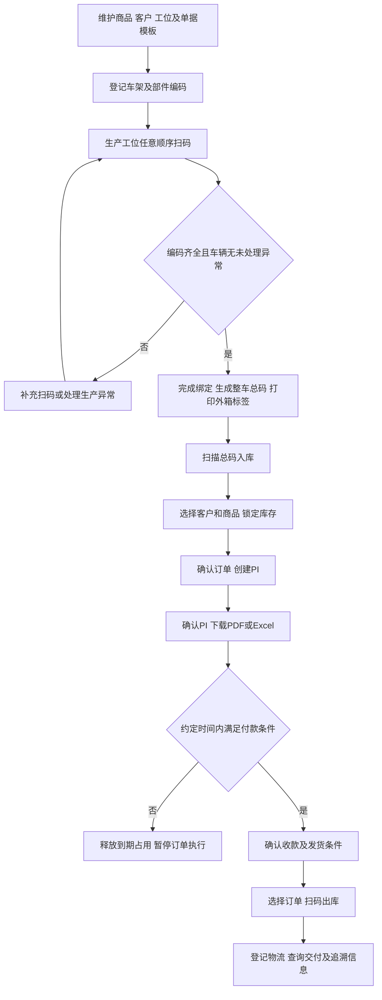
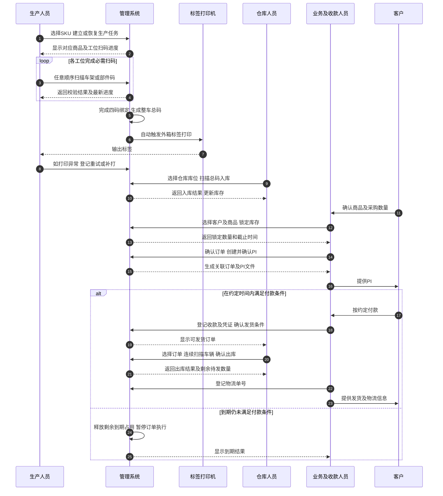

# E-Bike 生产与 PI 订单系统建设方案

| 项目 | 内容 |
| --- | --- |
| 项目名称 | E-Bike 生产与 PI 订单管理系统 |
| 建设范围 | 生产扫码、整车仓储、业务订单及 PI 单据管理 |
| 交付形式 | Web 管理系统、PDA/手机浏览器作业端及相关交付资料 |
| 计划周期 | 1–1.5 个月 |
| 文档版本 | V1.0 |

本方案说明生产与 PI 订单系统的功能清单、业务流程、腾讯云服务器与存储配置、实施计划及准备事项。

## 一、项目建设目标

建设一套覆盖 E-Bike 生产、整车仓储及 PI 订单业务的管理系统，实现车辆从生产组装、扫码绑定、标签打印、入库、库存锁定、PI 生成到出库发货的全过程管理。

项目达到以下业务目标：

1. **一车一档。**以车架 SN 为车辆唯一业务标识，关联电机、电池、仪表编码，形成完整整车档案。
2. **生产可追溯。**支持分工位扫码、生产异常登记及厂内换件记录，可通过车架码、任一部件码或整车总码查询相关信息。
3. **仓储可核对。**整车扫码入库、按订单扫码出库，清晰展示实物库存、锁定数量、订单占用及可售数量。
4. **PI 自动生成。**客户、商品及订单信息自动带入内销、外销 PI 模板，生成可下载的 PDF 和 Excel 文件。
5. **单据相互关联。**库存锁定、PI、销售订单、出库车辆和物流信息可关联查询。
6. **图片集中管理。**产品图片、生产异常图片、业务凭证及单据附件统一保存，支持按业务权限查看。

## 二、建设范围与使用方式

### 2.1 系统组成

| 系统 | 使用人员 | 主要用途 |
| --- | --- | --- |
| Web 管理系统 | 管理人员、生产主管、仓库人员、业务人员 | 基础资料维护、生产查询、库存与订单管理、PI 生成、统计查询 |
| PDA/手机浏览器作业端 | 生产工位人员、仓库人员 | 生产扫码、异常登记、入库、出库及追溯查询 |
| 客户/代理商授权视图 | 经授权的客户或代理商 | 查看授权库存、本方锁定记录、已发布 PI 及物流单号 |
| 标签打印功能 | 生产及包装岗位 | 外箱标签打印、补打及打印记录查询 |

账号由管理员统一开通，按岗位分配操作权限和数据查看范围。同一人员可根据实际工作需要配置多个岗位权限。

### 2.2 本期建设内容

| 项目 | 建设内容 |
| --- | --- |
| 业务场景 | 单工厂生产及整车仓储业务，支持仓库、库位登记 |
| 生产编码 | 车架、电机、电池、仪表四码绑定及整车总二维码 |
| 商品管理 | 支持一个车型对应多个 SKU，维护商品名称、规格及商品条码 |
| PI 模板 | 内销模板 1 套、外销模板 1 套；每套提供 PDF、Excel 两种输出格式 |
| 外箱标签 | 首期规划 2 种标签版式，各版式可应用于多个 SKU，具体内容按提供的标签样稿配置 |
| 打印设备 | 首期适配 1 个现场打印机型号及对应连接方式 |
| 业务数据 | 上线后的生产及订单数据，以及上线所需的商品、客户等基础资料 |
| 部署环境 | 腾讯云生产环境 1 套，具体资源配置见第五章 |

本期聚焦生产、整车仓库与 PI 订单。PI 在系统内生成，支持固定模板导出；物流单号手工登记。零部件库存继续使用现有 ERP，售后业务后续规划，往年业务流水不迁移。

## 三、功能清单

### 3.1 基础资料与权限管理

| 编号 | 功能 | 交付内容 |
| --- | --- | --- |
| 01 | 车型及 SKU 管理 | 维护车型、SKU、商品名称、规格、产品图片、商品条码及启用状态；选择 SKU 后自动带出标签和 PI 所需资料 |
| 02 | 客户资料管理 | 维护客户名称、联系人、联系方式、地址、国家/地区及业务归属，支持查询和编辑 |
| 03 | 卖方及收款资料 | 维护 PI 使用的卖方信息、收款银行资料及常用商务条款，按权限控制修改 |
| 04 | 工位及仓库资料 | 维护生产工位、扫码类型权限、仓库及库位资料；不限制四码扫描顺序 |
| 05 | 账号与岗位权限 | 配置管理员、生产、仓库、业务及收款确认等岗位权限；客户/代理商仅查看本方授权信息 |
| 06 | 基础资料导入 | 提供客户、商品及部件编码等约定格式的 Excel 导入模板，显示导入结果和错误原因 |

### 3.2 生产扫码与标签打印

| 编号 | 功能 | 交付内容 |
| --- | --- | --- |
| 07 | 整车建档 | 登记车架 SN、对应 SKU 和生产批次，建立车辆档案，防止重复建档 |
| 08 | 分工位扫码 | 选择 SKU 建立生产任务，按任意顺序扫描车架、电机、电池、仪表；按任务号恢复或跨工位交接，保存各工位作业进度 |
| 09 | 扫码校验 | 校验编码类型、格式、重复扫描、部件占用和异常状态，提示具体错误原因 |
| 10 | 四码绑定与总码生成 | 必需编码全部校验通过后完成整车绑定，生成唯一整车总二维码 |
| 11 | 外箱标签生成 | 按 SKU 带出车型、商品名称、商品条码等信息，将整车总码填入对应标签版式 |
| 12 | 自动打印与补打 | 完成最后一道必需扫码后自动触发标签打印；支持失败提示、重试、授权补打和打印记录查询 |
| 13 | 生产异常登记 | 登记异常原因和现场图片，对异常车辆进行隔离提示，阻止未经处理的车辆继续入库或出货 |
| 14 | 厂内换件 | 支持出货前更换电机、电池、仪表，记录新旧部件、原因、人员和时间；被判定为不良的旧件不得继续装配 |
| 15 | 整车追溯 | 通过总码、车架码或任一关联部件码查询车辆档案、生产、换件、入库及出库记录 |

### 3.3 整车库存与出入库

| 编号 | 功能 | 交付内容 |
| --- | --- | --- |
| 16 | 扫码入库 | 选择仓库和库位，扫描整车总码办理入库；不重复录入部件信息，防止未完成车辆及重复入库 |
| 17 | 库存查询 | 按 SKU、仓库、库位查询实物库存、异常隔离、临时锁定、订单占用及可售数量 |
| 18 | 库存锁定与释放 | 按客户、SKU 和数量锁定可售库存；支持主动释放、到期释放和记录查询 |
| 19 | 锁定转订单 | 业务确认后建立销售订单及关联 PI，自动带入客户和商品数量，保持库存占用连续 |
| 20 | 按订单扫码出库 | 选择客户及订单后连续扫描车辆，校验 SKU、数量和发货条件，批量确认出库 |
| 21 | 分批出库 | 支持同一订单分批发货，显示各商品应发、已发和待发数量 |
| 22 | 出入库更正 | 授权人员可填写原因更正符合条件的出入库记录，保留原记录及更正记录，同步调整相关数量 |

### 3.4 PI 订单与发货管理

| 编号 | 功能 | 交付内容 |
| --- | --- | --- |
| 23 | PI 创建与编辑 | 从关联订单带入客户、SKU 和数量，补充价格、币种、交期、付款及运输条款；支持一份 PI 包含多行商品 |
| 24 | PI 金额计算 | 根据确认的单价、数量、折扣、运费及税费口径计算金额，保持页面和导出文件一致 |
| 25 | 内销与外销模板 | 按两套定稿模板分别生成 PI，支持商品图片、中文或外文字段和多页明细 |
| 26 | PI 预览与下载 | 提供预览及 PDF、Excel 下载；草稿与正式单据有明确区分 |
| 27 | PI 修订与历史 | 已确认 PI 修改时生成新版本，保留旧版本；历史单据不因客户或商品资料修改而变化 |
| 28 | 收款确认与发货条件 | 授权人员登记收款金额、日期、凭证及备注，根据订单约定的付款条件确认库存保留及发货放行 |
| 29 | 订单进度查询 | 查询订单、PI、收款情况、已出库车辆及剩余待发数量，支持取消未履约部分并释放对应库存 |
| 30 | 物流信息登记 | 按发货批次登记承运商、物流单号、发货日期及备注，支持查询和复制单号 |

### 3.5 图片、报表与操作记录

| 编号 | 功能 | 交付内容 |
| --- | --- | --- |
| 31 | 图片及附件管理 | 上传、预览和下载产品图、生产异常图、收款凭证及业务附件，按所属业务控制访问范围 |
| 32 | 业务工作台 | 展示生产完成情况、库存情况、即将到期锁定、待处理 PI 及待发货订单 |
| 33 | 查询与导出 | 按车辆编码、客户、SKU、PI 号、日期等查询；支持整车、库存、订单及出入库列表导出 |
| 34 | 操作记录 | 保留关键生产、换件、锁定、转单、收款、出入库、补打及资料修改记录 |

## 四、业务流程与主要规则

### 4.1 整体业务流程

### 4.2 整体业务时序图

### 4.3 生产与标签规则

1. 同一车架 SN 只建立一份整车档案，同一部件不能同时装配于两台整车。
2. 四码扫描顺序不受限制，车架可最后扫描。总码生成前使用生产任务号恢复或交接；未登记的新车架明确选择车架类型，部件编码预先登记或导入。总码生成后，可通过总码查询对应四码和车辆信息。
3. 总码用于识别车辆并查询档案，外箱标签按确认版式显示商品及编码信息。
4. 四码齐全、校验通过且生产异常已处理后，完成整车绑定并触发打印。
5. 补打使用原车辆总码，不重复建档、不增加库存。换件保留历史关联。
6. 标签尺寸、字段和商品条码类型按提供的样张配置，打印方式与现场设备匹配。

### 4.4 库存与订单规则

1. 实物库存表示实际已入库且尚未出库的整车数量。
2. 可售库存为实物库存扣除不可售车辆、有效临时锁定及订单占用后的数量。
3. 锁定按客户、SKU 和数量办理，默认有效期为 48 小时，页面显示明确的截止时间。
4. 业务确认并生成 PI 后，原锁定转为订单占用；不减少实物库存，也不重复扣减可售数量。
5. 未满足付款条件的订单占用沿用原锁定截止时间，重新下载或修改 PI 不自动延长锁定期限。
6. 收款人员按订单约定的付款条件登记确认。满足保留库存条件的订单继续占用库存；满足发货条件后才可出库。
7. 超时释放后继续履约，应重新核对并占用可售库存。
8. 只有实际出库才减少实物库存，同时核减对应订单占用和待发数量。
9. 同一车型下不同规格的 SKU 分别管理，不相互替代出货。一个出库批次中有车辆校验失败时，该批次不予完成。

数量示例：

| 业务动作 | 实物库存 | 临时锁定 | 订单占用 | 可售库存 |
| --- | ---: | ---: | ---: | ---: |
| 初始库存 | 100 | 0 | 0 | 100 |
| 锁定 10 台 | 100 | 10 | 0 | 90 |
| 确认订单并生成 PI | 100 | 0 | 10 | 90 |
| 完成其中 4 台出库 | 96 | 0 | 6 | 90 |
| 取消剩余 6 台未履约数量 | 96 | 0 | 0 | 96 |

### 4.5 PI、图片及权限规则

- PI 按确认的内销、外销模板生成。模板包含金额、币种、税费、付款和运输条款。
- 已确认 PI 保留生成时的客户、商品、金额及条款；修改后以新修订版本发布。
- PDF 与 Excel 的商品、数量、金额及币种保持一致。
- 图片与附件关联对应业务，只有授权人员可以查看或下载。
- 客户/代理商只能查看本方授权资料；生产、仓库和业务岗位按配置使用相关功能。

## 五、服务器配置与存储方案

### 5.1 腾讯云配置建议

系统部署在企业自有腾讯云账号下，建议选择广州地域，便于惠州工厂使用。图片和单据采用独立对象存储，业务服务器负责系统运行。

| 资源 | 推荐配置 | 配置理由 | 官方购买/开通地址 |
| --- | --- | --- | --- |
| 云服务器 CVM | 1 台，4 核 CPU、16GB 内存 | 运行管理系统及作业端服务，为单据生成和日常业务保留处理空间 | [腾讯云 CVM 购买](https://buy.cloud.tencent.com/cvm) |
| 服务器磁盘 | 100GB 系统盘、200GB SSD 数据盘 | 分别存放系统、应用、日志和临时文件，便于维护和扩容 | 在 [CVM 购买页](https://buy.cloud.tencent.com/cvm) 配置 |
| 公网带宽 | 初始 5Mbps，可按使用情况升级至 10Mbps | 满足日常业务访问，图片由对象存储单独传输 | 在 [CVM 购买页](https://buy.cloud.tencent.com/cvm) 配置 |
| 云数据库 MySQL | 高可用版，2 核、4GB 内存、200GB 存储 | 独立保存车辆、订单、库存和业务记录，支持备份及恢复 | [腾讯云 MySQL 购买](https://buy.cloud.tencent.com/cdb) |
| 对象存储 COS | 初始按 2TB 标准存储用量规划，可扩展至 5TB 及以上 | 集中保存大量图片、PI 文件和附件，持续增加容量而无需更换业务服务器 | [COS 资源包购买](https://buy.cloud.tencent.com/cos)；[COS 控制台](https://console.cloud.tencent.com/cos) |
| 数据备份 | 数据库自动备份、服务器快照及重要文件版本保留 | 支持误操作和故障后的数据恢复 | 在对应产品控制台配置 |
| 域名与 HTTPS | 企业域名及有效 HTTPS 证书 | 提供统一访问地址和加密访问 | [腾讯云 SSL 证书](https://cloud.tencent.com/product/ssl) |

购买时按上述配置选择在售产品，实际价格以腾讯云购买页面为准。应用、数据库和对象存储采用同一地域，便于统一管理和数据访问。

### 5.2 图片存储说明

图片、单据与业务数据库分开存储，产品和订单页面展示预览图，需要时查看原图。初始按 2TB 图片及文件用量规划，并根据实际增长扩容。

以每年 6,000 台、每台 20 张图片、平均每张 5MB 计算，原始图片约 600GB/年；考虑预览图、单据和文件版本，2TB 可提供较充足的初期存储空间。若每台图片数量或清晰度显著提高，可调整至 5TB 或更高用量规划。

COS 按实际存储及相关用量计费，2TB 为初始用量规划或资源包抵扣额度，并非存储桶容量上限。文件下载流量、请求、图片处理及备份等费用按腾讯云实际计费规则执行。

### 5.3 资源准备与日常维护

- 准备企业云账号、域名和 HTTPS 证书，配置正式系统访问地址。
- 开启数据库自动备份和重要文件版本保留，定期检查备份结果。
- 设置服务器磁盘、图片存储用量及费用告警，根据实际增长扩容。
- 云资源、域名和证书到期前及时续费，保持系统持续可用。

## 六、实施计划与交付周期

整体计划为 **1–1.5 个月**。第 1 个月完成主要功能并进入试运行，随后完成全流程联调、现场验证和上线准备。

| 阶段 | 计划时间 | 实施内容 | 阶段成果 |
| --- | --- | --- | --- |
| 第一阶段：资料与方案确认 | 第 1–7 日 | 确认业务流程、商品编码、PI 模板、外箱标签、设备清单和页面样式，准备部署环境 | 业务流程、字段清单、模板样稿及设备清单确认 |
| 第二阶段：生产与仓库建设 | 第 8–18 日 | 完成生产扫码、整车总码、标签打印、异常处理、入库及库存管理 | 可演示的生产、打印、入库流程 |
| 第三阶段：PI 订单业务建设 | 第 19–30 日 | 完成库存锁定、订单关联、PI 生成、收款登记、出库及物流信息功能 | 生产至 PI、出库的主流程试运行版本 |
| 第四阶段：联调与试运行 | 第 31–38 日 | 完成全流程联调、真实设备操作、权限与数据核对、图片附件和报表验证 | 完整系统版本、问题处理记录、操作资料 |
| 第五阶段：现场验证与上线 | 第 39–45 日 | 在惠州工厂进行现场测试、培训和问题修正，完成正式部署 | 可用系统、操作资料、培训及验证记录 |

项目启动时确定各阶段实际日期，并安排模板资料、现场设备和部署环境的准备工作。

试运行开始后，现有纸质记录与系统数据并行核对约 1 个月，每天核对生产、入库和出库数量。并行核对可持续至正式上线后，数据稳定后逐步切换为系统作业。

## 七、准备事项与待办清单

### 7.1 业务资料与现场准备

| 序号 | 事项 | 提供/确认内容 | 时间节点 |
| --- | --- | --- | --- |
| 1 | 项目对接人员 | 指定生产、仓库及业务对接人 | 项目启动时 |
| 2 | 商品及编码资料 | 车型、SKU、商品名称、规格、商品条码对应表及实际编码样例 | 第一阶段 |
| 3 | 生产工位流程 | 各工位扫码类型权限、人员权限、任务交接和异常处置要求；四码不限制顺序 | 第一阶段 |
| 4 | 外箱标签样稿 | 标签尺寸、字段、版式、图片及打印样张 | 第一阶段 |
| 5 | PI 模板和样单 | 内销、外销可编辑模板及已填写样单，明确金额计算和商务条款 | 第一阶段 |
| 6 | 库存与付款规则 | 锁定时限、定金或收款要求、发货条件及未履约订单处理方式 | 第一阶段 |
| 7 | 账号及基础资料 | 组织岗位、使用人员、客户、仓库和库位资料 | 第一至第二阶段 |
| 8 | 设备与网络 | 提供约定型号的 PDA、扫码枪、打印机、标签纸及可用工厂网络 | 第一阶段提供样机，试运行前设备到位 |
| 9 | 云资源及域名 | 确认采购配置，提供部署所需授权，完成域名相关手续 | 第一阶段启动，试运行前具备访问条件 |
| 10 | 上线初始库存 | 确认旧库存是否纳入新系统；纳入时提供盘点及车辆编码清单 | 试运行前 |
| 11 | 图片及文件规则 | 提供产品图、实际拍摄样图，确认文件用途和保留要求 | 第一至第二阶段 |
| 12 | 试运行与现场验证 | 安排业务操作人员、每日核对人员和现场验证人员 | 第四至第五阶段 |

### 7.2 系统建设与上线准备

| 序号 | 事项 | 完成内容 | 时间节点 |
| --- | --- | --- | --- |
| 1 | 页面及样稿 | 完成页面样式、商品字段对应、PI 和外箱标签样稿确认 | 第一阶段 |
| 2 | 功能建设 | 完成第三章所列功能，提供阶段演示 | 第二至第三阶段 |
| 3 | 打印及扫码适配 | 完成约定设备的扫码、打印、补打和异常处理验证 | 第二至第四阶段 |
| 4 | 系统联调 | 验证生产、库存、订单、PI、收款、出库及物流关联 | 第四阶段 |
| 5 | 部署与恢复验证 | 完成环境部署、访问配置、备份设置及恢复验证 | 第四至第五阶段 |
| 6 | 培训与问题处理 | 提供操作培训，整理并处理现场使用发现的问题 | 第五阶段 |
| 7 | 使用资料 | 准备使用手册、配置与备份说明及现场验证记录 | 正式上线时 |

## 八、建设成果

| 序号 | 成果 | 内容说明 |
| --- | --- | --- |
| 1 | Web 管理系统 | 已部署、可登录使用的管理系统及访问地址 |
| 2 | PDA/手机浏览器作业端 | 可用于生产扫码、仓库作业和追溯查询的访问入口 |
| 3 | 标签打印功能 | 约定设备上的打印配置、标签模板和补打功能 |
| 4 | PI 模板及导出功能 | 内销、外销模板各 1 套，PDF 和 Excel 生成能力 |
| 5 | 云环境与图片存储 | 生产环境配置、图片及附件存储配置、备份设置 |
| 6 | 部署及操作资料 | 部署包、环境配置清单、使用手册、备份与恢复说明 |
| 7 | 培训及使用记录 | 操作培训记录、现场验证结果和问题处理记录 |
