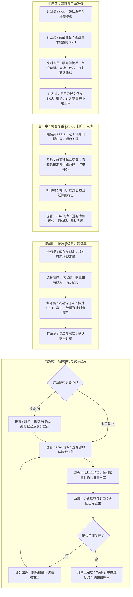
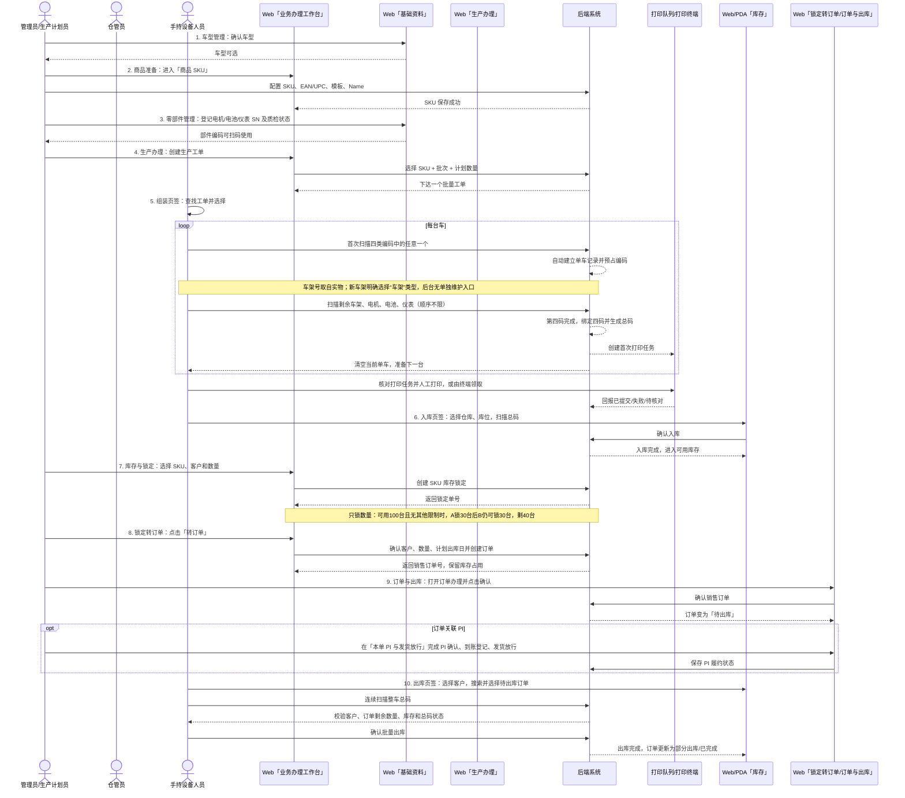

# 生产到出库业务流程图与角色时序图

## 一句话入口

后台日常操作统一进入 **工作台 → 业务办理工作台**；原来的「生产中心」「库存锁定」「销售订单」菜单仍保留，用于全量查询和补充管理。PDA 日常操作进入 **组装、入库、出库** 三个页签。

## 业务流程图

入口：**业务办理工作台 → 生产到出库操作说明**。页面只保留这一个说明按钮，点击直接查看业务流程图；点击节点可查看详细步骤，切换「角色时序图」可按四个阶段查看岗位交接，也可切换「逐步操作」查看文字说明。

以上是从 SKU 库存锁定转销售订单的操作主线；关联 PI 的订单还需满足对应放行条件。已有可用资料或库存时可从对应阶段开始，无需重复建档或生产。

## 什么时候由谁操作

| 阶段 | 开始条件 | 负责人员与位置 | 交给下一岗位的结果 |
| --- | --- | --- | --- |
| 准备 | 首次生产或新增规格 | 计划员、来料人员 / Web | 可用 SKU、三个部件 SN、已下达工单 |
| 生产入库 | 工单已下达、部件可用 | 组装、打印、仓管人员 / PDA 和打印队列 | 贴好标签的车辆、已入库数量 |
| 锁定转单 | 已有合格库存、客户确定需求 | 内部业务员、订单员 / Web | 客户锁定数量、销售订单与待发数量 |
| 放行出库 | 待出库或部分出库订单仍有余量 | 销售、财务、仓管人员 / Web 与 PDA | 放行结果、实际出库车辆与出库记录 |

## 角色时序图

页面中的角色时序图按以下四个阶段展开，每一步都可点击查看操作位置、输入资料、校验规则、完成结果和异常处理。蓝色是岗位操作，绿色虚线是系统反馈，紫色是岗位交接，橙色是有条件才执行的分支。

| 阶段 | 细化范围 | 条件与异常 |
| --- | --- | --- |
| 资料准备 | 确认车型 → 标签模板 → 创建 SKU → 保存反馈 → 三个部件 SN → 实物车架交接 → 批量工单 → 已下达反馈 → 工位交接 | 已有资料可复用；车架号来自实物；计划数量不增加库存 |
| 生产与入库 | 选工单 → 首码 → 单车进度 → 剩余编码 → 第四码自动完成 → 领取打印 → 贴标交接 → 确认入库 → 入库反馈 | 扫错取消未完成单车并重扫；打印不确定先核对再补打；未组装、重复入库或异常车辆不能直接入库 |
| 锁定与转单 | 刷新可用量 → 客户数量有效期 → 锁定反馈 → 从锁定转单 → 订单占用反馈 → 确认订单 → 待发交接 | 过期、超量、客户不符或承诺缺少库存支撑时先处理，不能强行转单 |
| 放行与出库 | 判断 PI → PI 确认 → 实际到账 → 授权放行 → 结果反馈 → 选客户订单 → 逐台扫总码 → 整批确认 → 成功反馈 → 交回记录 | 无 PI 跳过 PI 环节；有关联 PI 必须达到发货收款要求并授权放行；任一业务校验失败整批回滚；网络结果不明先查记录 |

图中只显示当前阶段参与的岗位。右侧说明可通过「上一步 / 下一步」连续阅读，也可展开全部文字步骤。阶段内的「下一阶段」用于继续查看说明，不会执行生产、锁定、收款或出库操作。

## 按步骤怎么操作

### 1. 确认车型

位置：后台左侧 **系统管理 → 车型管理**。

确认车型编码、名称处于启用状态。车型是 SKU 的上级资料；没有可用车型，后续 SKU 无法建立。

### 2. 配置模板并创建 SKU

位置：推荐进入 **工作台 → 业务办理工作台 → 商品准备**；也可进入 **生产与库存 → 生产中心 → 商品 SKU**。

在 SKU 表单选择车型，填写 SKU、商品名称、规格、EAN/UPC 等标签信息，选择标签模板并保存。Name 是 SKU 下的一对多名称明细，需要多名称时在该 SKU 的 **Name 列表**中登记。标签模板位置是 **生产中心 → 标签模板**，模板应先发布/启用，再在 SKU 中选择。

### 3. 登记三个部件

位置：后台左侧 **系统管理 → 零部件管理**。

按实物逐条登记 **电机、电池、仪表** 的 SN，并选择部件类型、供应商、批次和质检状态。这就是“登记三个部件”。车架 SN 来自实物，当前后台没有单独维护车架号的页面。新车架由 PDA 将编码类型明确选为「车架」，扫描或手动录入实物号码，不能随意编写；四码齐全后系统自动建立整车档案。电机、电池、仪表 SN 应先登记并处于可用状态，才能通过生产扫码校验。

### 4. 创建生产工单

位置：**工作台 → 业务办理工作台 → 生产办理**，点击 **创建工单**；旧入口是 **生产中心 → 生产工单 → 创建工单**。

选择已启用 SKU，填写统一生产批次和计划数量，例如 100 台，点击 **创建工单**。一张工单对应一个 SKU、一个批次和计划数量，不需要为 100 台车创建 100 张工单。

### 5. PDA 扫四码

位置：PDA/H5 → **组装**。

先在「查找工单」输入工单号、SKU 或批次，点 **搜索 / 刷新**，再选择已下达工单。编码类型默认 **自动识别**；新车架第一次扫不出来时，将编码类型切为 **车架**。依次扫描车架、电机、电池、仪表，顺序不限。首码会自动建立单车记录，第四码完成即绑定四码、生成总码、创建打印任务并清空当前单车。扫错码点 **取消当前单车并释放占用**，填原因后重扫。

### 6. 打印并入库

打印：PDA 组装页「上一台已完成」区域可刷新打印任务、预览并人工打印；后台可在 **生产办理 → 打印队列**查看、预览、补打。自动打印终端领取任务时，系统的 `SUBMITTED` 只代表提交到队列，仍要核对实物出纸。

入库位置：PDA/H5 → **入库**。选择仓库、库位，扫描整车总码，点击 **确认入库**。后台可在 **生产与库存 → 库存管理 → 入库记录**查询结果。入库后该车才进入可用库存。

### 7. 锁定 SKU

位置：**工作台 → 业务办理工作台 → 库存与锁定**；旧入口是 **SKU 库存锁定**。

按 SKU 查看 **可新增锁定** 数量，加入要承诺给客户的 SKU，在「待锁定商品」中填写数量，再点击 **选择客户并锁定** 或 **锁定所选 SKU**，选择客户、可选代理商和截止时间，点击 **确认锁定**。锁定按 SKU 数量执行，不指定具体车架 SN，也不禁止该 SKU 继续销售。假设合格可用库存为 100 台且没有其他限制，A 锁 30 台后，B 仍可锁 30 台，剩余 40 台。实际锁定上限同时受 SKU 余量和车型余量限制。

### 8. 转销售订单并确认

位置：工作台进入 **锁定转订单**，找到锁定记录，点击 **转订单**。确认固定 SKU、客户、转换数量、计划出库日，点击 **创建订单**。创建成功后会直接打开订单办理窗口；也可进入 **业务协同 → 销售订单**，点击订单的 **订单办理**。

在订单办理窗口点击 **确认订单，继续出库**。订单状态变为 **待出库**。如订单有关联 PI，点击 **本单 PI 与发货放行**完成 PI 确认、到账登记、发货放行后再出库。

### 9. PDA 出库

位置：PDA/H5 → **出库 → 按订单出库**。

先选择客户，再输入订单号或车型搜索，选择状态为 **待出库** 或 **部分出库且仍有待发数量** 的订单。连续扫描整车总码，确认扫描数量和剩余数量后点击 **确认批量出库**。系统会再次校验客户、订单剩余数量、车辆库存和总码状态，成功后订单变为 **部分出库** 或 **已完成**。

## 不要混淆的自动动作

- 创建工单不会为每台车生成独立工单；每台车在 PDA 首次扫码时自动生成单车记录。
- SKU 表示一种确定的商品配置，车架号标识具体车辆；生产计划数量不等于已入库库存。
- 第四码完成会自动生成总码和打印任务，但不会替你确认实物打印、入库或销售订单。
- 锁定 SKU 只锁数量，不锁具体车架；PDA 出库时才按总码选择实际车辆。
- 页面跳转只带入 SKU、工单号或订单号，不会自动执行确认、入库、出库等写操作。
